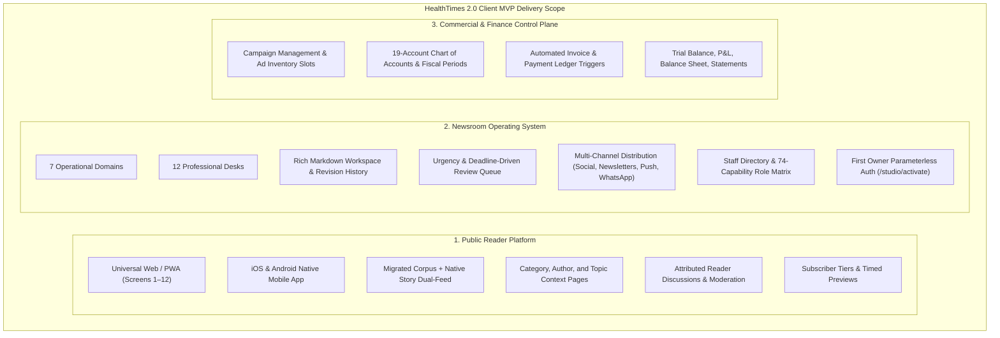
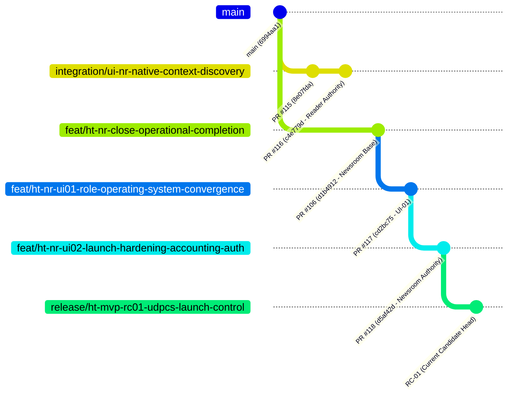

# HealthTimes 2.0 MVP Delivery Control Center

**Document Identifier:** `HT-MVP-DELIVERY-CONTROL-CENTER`  
**Governing Standard:** 11-11 Tech Universal Digital Platform Capability Standard — UDPCS 1.0  
**Programme:** HealthTimes 2.0 (Reader + Newsroom OS + Commercial + Finance + Distribution + Platform)  
**Target Client Handoff:** 24 October 2026  
**Document Owner:** HealthTimes MVP Release Assurance / Client Delivery Lead  
**Last Verified At:** 2026-10-21  
**Target Release Candidate Head:** `release/ht-mvp-rc01-udpcs-launch-control`  
**Controlling Base Commit:** `d5af42d6b7018dfd3451ac9d621482e0edf9664f` (PR #118)  
**Staging Environment:** Supabase Postgres 17.6 (`gcdohgbmqhqwydgaxrcr`)  
**Staging Migration Level:** Migration 96 (`20261021050000_ht_nr_rc01_owner_auth_email_verification.sql`)  
**Overall Decision:** `GO_FOR_CLIENT_DRY_RUN` (Conditional on final release branch integration)

---

## 1. What HealthTimes Is

HealthTimes 2.0 is an enterprise-grade digital health journalism platform and modern newsroom operating system built specifically for Southern Africa and global public health reporting.

The platform unifies three core operational pillars:
1. **Public Reader Experience:** A fast, accessible, offline-capable progressive web application and cross-platform native mobile reader providing public health journalism, interactive live coverage, video health series, audio listen feeds, and tiered subscriber memberships.
2. **Newsroom Operating System (Newsroom OS):** A comprehensive staff workspace structured across 7 operational domains and 12 specialized desks—encompassing reporter story drafting, multi-stage editorial review, homepage curation, digital asset management, breaking news live coverage, and multi-channel audience distribution (Social, Newsletters, Push Alerts, and WhatsApp).
3. **Commercial & Financial Control Plane:** A double-entry general ledger (GAAP/IFRS aligned) integrating ad sales, sponsor campaigns, automated invoice-to-ledger postings, payment settlements, expense claims, credit notes, and real-time financial reporting (Trial Balance, P&L, Balance Sheet, and Customer Statements).

---

## 2. What Is Being Delivered for MVP

---

## 3. Controlling Release Topology & Branch Lineage

An exhaustive audit of the git ancestry reveals that HealthTimes currently possesses two fully certified parallel lines of development diverged from canonical `main` (`6994aa18d37e2189dbc1d3f8efc76a638ee0971c`):

1. **Reader Authority Line (PR #116 @ `c4e779db`):** Contains the accepted UI-WF-01 through UI-WF-05 Reader screens, UI-NR-CONV-01 native story mapper, and UI-NR-CONV-02 native context discovery RPC.
2. **Newsroom Authority Line (PR #118 @ `d5af42d6`):** Contains the accepted PR #106 Newsroom OS foundation, HT-NR-UI-01 7-domain operating system, and HT-NR-UI-02 launch hardening, double-entry GL, and first-owner auth.

### Topology Status:
- `SINGLE_RELEASABLE_HEAD_EXISTS=NO`
- `FINAL_READER_AUTHORITY=PR #116 (c4e779dbbc2b65232c90b4e69b74551b62f1910d)`
- `FINAL_NEWSROOM_AUTHORITY=PR #118 (d5af42d6b7018dfd3451ac9d621482e0edf9664f)`
- `RELEASE_INTEGRATION_BLOCKER=P0_RELEASE_INTEGRATION_REQUIRED`

> [!IMPORTANT]
> To produce a single production release binary and hosted deployment, the Newsroom authority (`release/ht-mvp-rc01-udpcs-launch-control`) and Reader authority (`integration/ui-nr-native-context-discovery`) must be merged in a governed wave prior to final production cut. Full details and the safe step-by-step merge order are set forth in [HT-MVP-RELEASE-TOPOLOGY.md](HT-MVP-RELEASE-TOPOLOGY.md).

---

## 4. Current Staging Environment Truth

- **Database Host:** Supabase Postgres 17.6
- **Project Ref:** `gcdohgbmqhqwydgaxrcr`
- **Total Applied Migrations:** 96 migrations recorded in `supabase_migrations.schema_migrations`
- **Migration Tip:** `20261021050000_ht_nr_rc01_owner_auth_email_verification.sql` (Migration 96)
- **Data Integrity:** Clean staging zero-state. Zero synthetic ad invoices, fake payments, or fictional news stories persisted outside test transaction envelopes.
- **Production Environment:** Strictly unauthorized. Zero production database access or external provider dispatches.

---

## 5. What Works (Proven Operational Capabilities)

| Capability Area | Operational Reality | Evidence Class |
|---|---|---|
| **Reader Web/PWA** | Complete 12-screen reader with responsive mobile, tablet, and desktop layouts; dark/light mode; offline persistence. | `TEST_PROVEN` & `STAGING_RUNTIME_PROVEN` |
| **Reader Discovery** | Dual-feed architecture fetching both migrated WordPress corpus and native Newsroom stories. | `SOURCE_PROVEN` & `TEST_PROVEN` |
| **Reader Context** | Category, Author, and Topic discovery surfaces with HTTPS media boundary enforcement. | `TEST_PROVEN` |
| **Story Drafting** | Rich Markdown editor, word counter, image insertion, metadata tags, revision restore. | `TEST_PROVEN` |
| **Review Queue** | Multi-stage editorial workflow (Draft -> In Review -> Changes Requested -> Approved -> Published). | `TEST_PROVEN` |
| **Homepage Curation** | Section ordering, lead story pinning, edition scheduling, breaking news alerts. | `TEST_PROVEN` |
| **Media Library** | Media upload, metadata tagging, public promotion pipeline, storage isolation. | `TEST_PROVEN` |
| **Audience Distribution** | UI consoles for Social, Newsletters, Push Alerts, and WhatsApp broadcasts with suppression rules. | `TEST_PROVEN` |
| **First Owner Auth** | Parameterless `newsroom_bootstrap_owner()` strictly bounded to confirmed `kudzimusar@gmail.com`. | `SOURCE_PROVEN` & `TEST_PROVEN` |
| **Double-Entry GL** | 19-account COA, fiscal period locks, immutable posted journals, automated invoice/payment triggers. | `TEST_PROVEN` & `STAGING_RUNTIME_PROVEN` |
| **Financial Statements** | Balanced Trial Balance, Profit & Loss Surplus, Balance Sheet equality, Customer Statements. | `TEST_PROVEN` & `STAGING_RUNTIME_PROVEN` |
| **Role-Based RBAC** | Strict domain gating across 7 personas ensuring complete segregation of duties. | `TEST_PROVEN` |

---

## 6. What Remains External (Provider Dependencies)

The core application code, UI desks, validation rules, and database functions are 100% operational. The following third-party credentials are client-managed dependencies:

1. **Meta WhatsApp Business API:** Requires client production WABA (WhatsApp Business Account) credentials and verified Meta Business Manager for live subscriber broadcasts. (Staging fallback: mock provider simulation).
2. **Brevo (Sendinblue) Transactional Email:** Requires client production API keys for external newsletter and subscriber emails. (Staging fallback: mock delivery simulator).
3. **Apple Developer & Google Play Console:** Requires client provisioning profiles and production keys for native App Store and Play Store app publishing. (Staging fallback: Expo local build & simulator).
4. **Google AdSense / Direct Ad Server:** Ad inventory slots (`home_leaderboard`, `article_inline`) are built and compliant with health advertising policy; client ad network IDs to be inserted at cutover.

---

## 7. What Remains Deferred (Controlled V1.1 Roadmap)

In accordance with UDPCS 1.0 governance, the following capabilities are explicitly classified as `FUTURE_V1_1`:
- **Public Developer Portal / External API Console:** (Internal RPCs are fully secured; public 3rd-party developer APIs deferred to V1.1).
- **Public MCP / External Agent Gateway:** (Newsroom AI fact-checking assistant is operational; external agent gateways deferred to V1.1).
- **Automated Multi-Region Disaster Recovery Failover:** (Manual point-in-time recovery runbooks documented; automated multi-cloud failover deferred to V1.1).
- **Corporate HR & Procurement Consoles:** (Staff directory and RBAC operational; corporate payroll/HR remains an external manual process).

---

## 8. Current Blocker & Issue Inventory (P0 / P1 / P2)

### P0 Blockers (Launch Critical):
1. **P0-1: `P0_RELEASE_INTEGRATION_REQUIRED`**  
   *Description:* The Reader authority (PR #116) and Newsroom authority (PR #118) currently live on parallel branches diverged from `main`. A single unified release candidate must be created before final production deployment.  
   *Mitigation:* Detailed in [HT-MVP-RELEASE-TOPOLOGY.md](HT-MVP-RELEASE-TOPOLOGY.md). Does NOT block internal rehearsal or Owner Preview demonstration.

### P1 Pre-Handoff Tasks:
1. **P1-1: Physical Owner Authentication Activation Ceremony**  
   *Description:* Kudzi Musarurwa must navigate to `/studio/activate`, sign up, confirm email ownership, and activate the live Publisher/Owner role on Staging.  
2. **P1-2: Pre-Flight Script Run on Clean Environment**  
   *Description:* Execute `scripts/release/ht-mvp-preflight.mjs` to verify all 16 delivery documents, 96 migrations, and git hashes.  
3. **P1-3: Internal Client Dry-Run Rehearsal**  
   *Description:* Conduct the 30–45 minute dry-run script with the internal team prior to the client demonstration.

### P2 Disclosed & Deferred Items:
- All 14 items listed in the [HT-MVP-V1.1-DEFERRED-REGISTER.md](HT-MVP-V1.1-DEFERRED-REGISTER.md) (external vendor keys, advanced analytics, self-service developer portal).

---

## 9. Master Document Navigation Index

All delivery documentation is consolidated in `docs/delivery/`:

| Document Name | File Path | Purpose |
|---|---|---|
| **Delivery Control Center** | [HT-MVP-DELIVERY-CONTROL-CENTER.md](HT-MVP-DELIVERY-CONTROL-CENTER.md) | Master front door and executive status overview |
| **UDPCS Capability Register** | [HT-MVP-UDPCS-CAPABILITY-REGISTER.md](HT-MVP-UDPCS-CAPABILITY-REGISTER.md) | Exhaustive 35-domain assessment across all 5 planes |
| **Feature Completeness Gates** | [HT-MVP-FEATURE-COMPLETENESS-GATES.md](HT-MVP-FEATURE-COMPLETENESS-GATES.md) | 9-dimension gate analysis for all material capabilities |
| **Capability Mirror** | [HT-MVP-CAPABILITY-MIRROR.md](HT-MVP-CAPABILITY-MIRROR.md) | 15-question architectural mirror for core workflows |
| **Evidence Register** | [HT-MVP-EVIDENCE-REGISTER.md](HT-MVP-EVIDENCE-REGISTER.md) | Truthful claim-to-evidence mapping with evidence classes |
| **Release Topology** | [HT-MVP-RELEASE-TOPOLOGY.md](HT-MVP-RELEASE-TOPOLOGY.md) | Git ancestry graph and safe branch integration order |
| **Go / No-Go Board** | [HT-MVP-GO-NO-GO.md](HT-MVP-GO-NO-GO.md) | Comprehensive launch decision matrix and scoring |
| **Client Dry Run Guide** | [HT-MVP-CLIENT-DRY-RUN.md](HT-MVP-CLIENT-DRY-RUN.md) | Complete 30–45 minute presentation flow and script |
| **Owner UAT Guide** | [HT-MVP-OWNER-UAT.md](HT-MVP-OWNER-UAT.md) | Hands-on walkthrough across all 7 staff personas |
| **External Provider Gates** | [HT-MVP-EXTERNAL-PROVIDER-GATES.md](HT-MVP-EXTERNAL-PROVIDER-GATES.md) | Status of Meta, Brevo, Apple, Google, and Supabase |
| **Operations Runbook** | [HT-MVP-OPERATIONS-RUNBOOK.md](HT-MVP-OPERATIONS-RUNBOOK.md) | Day-to-day newsroom and platform operating guide |
| **Incident Management Runbook** | [HT-MVP-INCIDENT-RUNBOOK.md](HT-MVP-INCIDENT-RUNBOOK.md) | SEV-1/2/3 definitions, containment, and recovery |
| **Backup & Disaster Recovery** | [HT-MVP-BACKUP-RECOVERY.md](HT-MVP-BACKUP-RECOVERY.md) | Data asset recovery procedures and limitations |
| **Security, Privacy & Legal Register** | [HT-MVP-SECURITY-PRIVACY-LEGAL-REGISTER.md](HT-MVP-SECURITY-PRIVACY-LEGAL-REGISTER.md) | Compliance registers and professional advisor gates |
| **Client Handoff Pack** | [HT-MVP-CLIENT-HANDOFF-PACK.md](HT-MVP-CLIENT-HANDOFF-PACK.md) | Client-facing delivery summary and acceptance form |
| **V1.1 Deferred Register** | [HT-MVP-V1.1-DEFERRED-REGISTER.md](HT-MVP-V1.1-DEFERRED-REGISTER.md) | Formal record of non-MVP capabilities and workarounds |
| **Machine-Readable Register** | [ht-mvp-capability-register.json](ht-mvp-capability-register.json) | JSON export of all 35 domains and material features |
