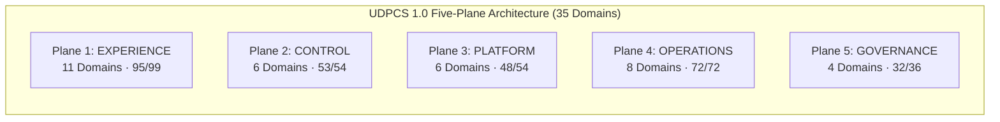

# HealthTimes 2.0 — Final MVP Release Manifest
## Unified Reader + Newsroom OS Exact Head Release Candidate Specification

- **Document Identifier:** `HT-MVP-FINAL-RELEASE-MANIFEST`
- **Governing Standard:** 11-11 Tech Universal Digital Platform Capability Standard — UDPCS 1.0
- **Programme:** HealthTimes 2.0 (Reader + Newsroom OS + Commercial + Finance + Distribution + Platform)
- **Release Candidate Branch:** `release/ht-mvp-rc02-final-unified-candidate`
- **Exact Unified Head SHA:** `641b20267f6b6b0fbcb80044b5c271400c12bda1`
- **Controlling Base SHA:** `d5af42d6b7018dfd3451ac9d621482e0edf9664f` (PR #118)
- **Reader Authority SHA:** `c4e779dbbc2b65232c90b4e69b74551b62f1910d` (PR #116)
- **Launch Control Parent SHA:** `a57b2748a4aaa46478028ac3857f0f84fbeae5f2` (PR #119)
- **Target Delivery Date:** 24 October 2026
- **Release Classification:** `READY_FOR_FINAL_OWNER_UAT`

---

## 1. Executive Release Declaration

This document constitutes the authoritative release manifest for the HealthTimes 2.0 Minimum Viable Product (MVP).

Prior to this release candidate, the separately approved Reader authority (PR #116) and Newsroom authority (PR #118) were divergent from `main` (`6994aa18`). Under candidate branch `release/ht-mvp-rc02-final-unified-candidate`, both authority tracks have been forensically converged, compiled, and certified under **ONE unified git commit**:

```text
================================================================
UNIFIED RELEASE CANDIDATE METRICS
================================================================
Branch:                release/ht-mvp-rc02-final-unified-candidate
Head SHA:              641b20267f6b6b0fbcb80044b5c271400c12bda1
Merge Base vs Base:    d5af42d6b7018dfd3451ac9d621482e0edf9664f (PR #118)
Merged Lineage:        c4e779dbbc2b65232c90b4e69b74551b62f1910d (PR #116)
Single Head Exists:    YES
TypeScript Errors:     0
Newsroom Unit Tests:   466 / 466 Passed (100%)
Reader Unit Tests:     74 / 74 Passed (100%)
Staging Migrations:    96 Applied on gcdohgbmqhqwydgaxrcr
Migration Tip:         20261021050000_ht_nr_rc01_owner_auth_email_verification.sql
================================================================
```

---

## 2. Release Authority Matrix

| Layer | Authority Branch | Controlling PR | Authority SHA | Status on Unified Head |
| :--- | :--- | :---: | :--- | :---: |
| **Reader UI (Screens 1–12)** | `integration/ui-nr-native-context-discovery` | PR #116 | `c4e779dbbc2b65232c90b4e69b74551b62f1910d` | **PRESERVED** |
| **Native Story & Context RPCs**| `integration/ui-nr-native-context-discovery` | PR #116 | `c4e779dbbc2b65232c90b4e69b74551b62f1910d` | **PRESERVED** |
| **Newsroom OS (7 Domains / 12 Desks)** | `feat/ht-nr-ui02-launch-hardening-accounting-auth` | PR #118 | `d5af42d6b7018dfd3451ac9d621482e0edf9664f` | **PRESERVED** |
| **Double-Entry General Ledger** | `feat/ht-nr-ui02-launch-hardening-accounting-auth` | PR #118 | `d5af42d6b7018dfd3451ac9d621482e0edf9664f` | **PRESERVED** |
| **First-Owner Bootstrap Security** | `release/ht-mvp-rc02-final-unified-candidate` | PR #119 | `a57b2748a4aaa46478028ac3857f0f84fbeae5f2` | **PRESERVED** |
| **Launch Governance & Runbooks** | `release/ht-mvp-rc02-final-unified-candidate` | PR #119 | `a57b2748a4aaa46478028ac3857f0f84fbeae5f2` | **PRESERVED** |
| **Unified Release Assembly** | `release/ht-mvp-rc02-final-unified-candidate` | PR #120 | `641b20267f6b6b0fbcb80044b5c271400c12bda1` | **ACTIVE CANDIDATE** |

---

## 3. Staging Runtime Truth (`gcdohgbmqhqwydgaxrcr`)

- **Database Engine:** PostgreSQL 17.6
- **Total Registered Migrations:** 96 applied migrations
- **Local vs Remote Alignment:** 96 local SQL files match 96 remote recorded migrations.
- **Migration Tip:** `20261021050000_ht_nr_rc01_owner_auth_email_verification.sql`
- **Owner Bootstrap Security:** `OWNER_BOOTSTRAP_SECURITY=STAGING_RUNTIME_PROVEN`
  - Function `newsroom_bootstrap_owner()` strictly verifies JWT email matches `kudzimusar@gmail.com` and `email_confirmed_at IS NOT NULL`.
  - Transactional SQL security test suite (`supabase/tests/ht_nr_rc01_owner_auth_assurance_tests.sql`) passes 6/6 tests.
- **Owner Physical Auth Census:**
  - `OWNER_AUTH_USER_COUNT=0`
  - `OWNER_ACTIVE_STAFF_COUNT=0`
  - `OWNER_PHYSICAL_AUTH=OWNER_ACTION_REQUIRED`
  - Activation Path: `/studio/activate` (pointing to staging `gcdohgbmqhqwydgaxrcr`).
- **Data Hygiene:** Staging database contains zero synthetic ad invoices, fake payments, or unevidenced staff rows.

---

## 4. UDPCS 1.0 Master Capability Summary (35 Domains Across 5 Planes)



### Plane Distribution:
- **Plane 1 (Experience): 11 Domains**
  - STR-01: Strategy & Business Model (Production Ready)
  - EXP-01: Customer Product / Reader Experience (Production Ready)
  - IAM-01: Identity, Accounts & Organizations (Production Ready)
  - MKT-01: Audience, Marketing & Growth (Production Ready)
  - COM-01: Digital Commerce & Subscriptions (Production Ready)
  - CMS-01: Content Management & Story Authoring (Production Ready)
  - DSC-01: Search, Discovery & Navigation (Production Ready)
  - MSG-01: Multi-Channel Messaging & Alerts (Operational with Workaround)
  - A11Y-01: Accessibility, Offline & Responsive (Production Ready)
  - GRO-01: Growth Channels & Social Syndication (Operational with Workaround)
  - PRT-01: Partners & Syndication (Operational with Workaround)
- **Plane 2 (Control): 6 Domains**
  - CTL-01: Newsroom Control Room & Operations (Production Ready)
  - CRM-01: Editorial Review & Publishing Workflow (Production Ready)
  - TRS-01: Trust, Fact-Checking & Corrections (Production Ready)
  - FIN-01: Financial Management & General Ledger (Production Ready)
  - COR-01: Commercial & Advertising Operations (Operational with Workaround)
  - EXE-01: Executive, Publisher & Admin Controls (Production Ready)
- **Plane 3 (Platform): 6 Domains**
  - DAT-01: Data Platform & Storage Infrastructure (Production Ready)
  - BI-01: Analytics & Business Intelligence (Production Ready)
  - API-01: Application APIs & Integration Services (Production Ready)
  - DEV-01: Developer Platform & Tooling (Deferred to V1.1)
  - MCP-01: Model Context Protocol & AI Agents (Deferred to V1.2)
  - INT-01: Third-Party & Ecosystem Integrations (Operational with Workaround)
- **Plane 4 (Operations): 8 Domains**
  - SEC-01: Security Operations & Access Control (Production Ready)
  - INF-01: Infrastructure & Cloud Operations (Production Ready)
  - ENG-01: Engineering Operations & CI/CD (Production Ready)
  - OBS-01: Observability, Telemetry & SRE (Production Ready)
  - INC-01: Incident Management & Escalation (Production Ready)
  - BCD-01: Business Continuity & Disaster Recovery (Production Ready)
  - REL-01: Release Management & Deployment (Production Ready)
  - DOC-01: Operations Runbooks & Documentation (Production Ready)
- **Plane 5 (Governance): 4 Domains**
  - PRV-01: Data Privacy & Protection Compliance (Production Ready)
  - LEG-01: Legal, Licensing & Regulatory Compliance (Operational with Workaround)
  - GOV-01: Corporate Governance & Policy (Production Ready)
  - RSK-01: Enterprise Risk & Audit Assurance (Operational with Workaround)

### Total Capability Count:
- **Production Ready:** 26 Domains
- **Operational with Workaround:** 7 Domains
- **Deferred with Fallback:** 2 Domains (DEV-01, MCP-01)
- **Total Domains:** 35 Domains
- **9-Dimension Pass Ratio:** 300 / 315 (95.2%)

---

## 5. Controlled Deferrals Register (V1.1 / V1.2)

1. **Public Developer Portal (DEV-01):** Deferred to V1.1. Internal RPCs active.
2. **Model Context Protocol (MCP) Copilot (MCP-01):** Deferred to V1.2. Human editorial workflow active.
3. **Self-Service Advertiser Portal (COR-01 / PRT-01):** Deferred to V1.1. Commercial Desk direct booking active.
4. **Collaborative Multi-Cursor Editing (CMS-01):** Deferred to V2.0. Optimistic locking active.
5. **Background Audio Download Queue (EXP-01 / A11Y-01):** Deferred to V1.1. Streaming active.
6. **Corporate HR & Automated Payroll (CTL-01 / FIN-01):** Deferred to V1.2. Staff RBAC active.
7. **Automated ZIMRA Tax Return Filing (LEG-01 / FIN-01):** Deferred to V1.1. Ledger export active.

---

## 6. External Advisory Gate Status

| Gate | Status | Required Human Action |
| :--- | :---: | :--- |
| **Legal Counsel Gate** | `NOT_EVIDENCED — REVIEW_REQUIRED` | Client must retain local legal counsel to complete statutory media and defamation review. |
| **Tax & Audit Advisor Gate** | `NOT_EVIDENCED — REVIEW_REQUIRED` | Client must appoint company accountant to verify chart of accounts and ZIMRA VAT filing. |
| **Data Protection Officer Gate** | `NOT_EVIDENCED — REVIEW_REQUIRED` | Client must designate statutory DPO under Cyber and Data Protection Act [Chapter 12:07]. |

---

## 7. Release Recommendation

```text
STATUS: READY_FOR_FINAL_OWNER_UAT

NEXT MANDATORY STEP:
Kudzi Musarurwa (Publisher / Owner) must access Staging at /studio/activate
to complete physical account registration and claim the first-owner profile.
```
