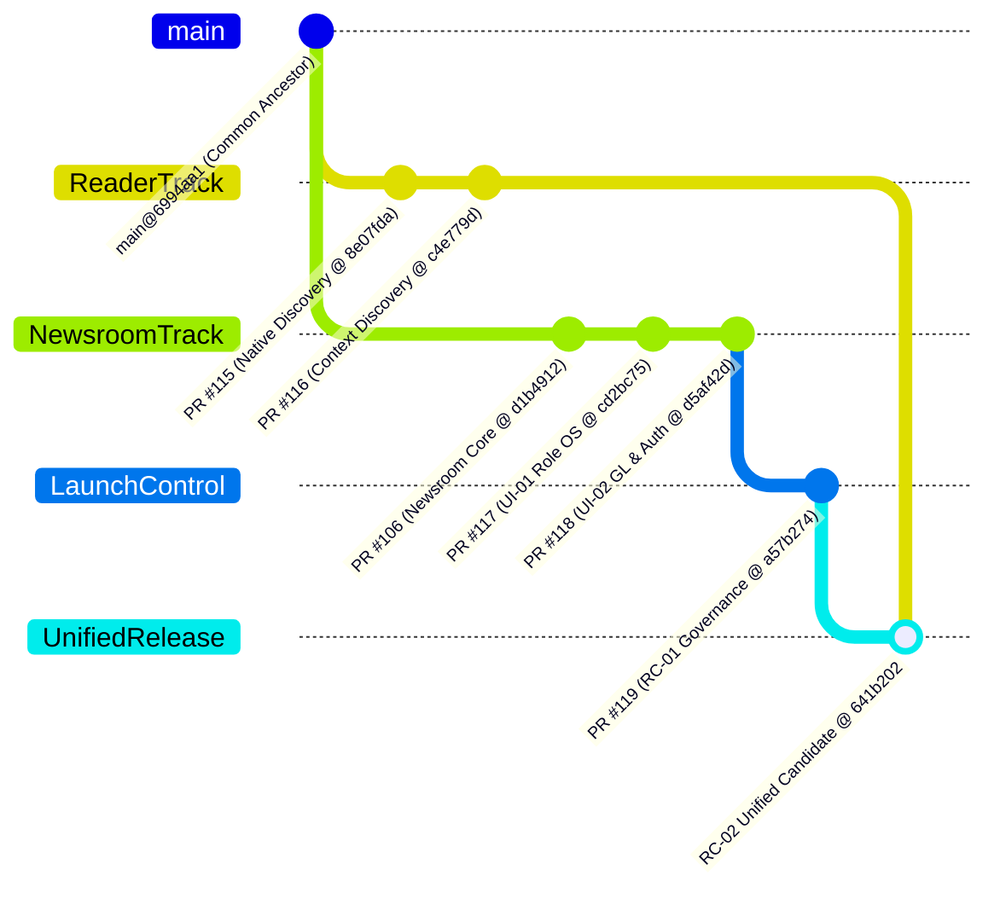

# HealthTimes 2.0 Release Topology & Lineage Audit
## Unified Release Architecture, Exact Head Authority & Branch Census

- **Document Identifier:** `HT-MVP-RELEASE-TOPOLOGY`  
- **Governing Standard:** 11-11 Tech UDPCS 1.0 — Plane 4 Operations & Release Control  
- **Programme:** HealthTimes 2.0  
- **Audit Date:** 2026-10-21  
- **Auditor:** HealthTimes Final MVP Release Integration Lead  
- **Current Classification:** `SINGLE_RELEASABLE_HEAD_EXISTS=YES` (`P0-REL-01=RESOLVED`)  
- **Unified Release Candidate Head:** `641b20267f6b6b0fbcb80044b5c271400c12bda1`  
- **Unified Release Candidate Branch:** `release/ht-mvp-rc02-final-unified-candidate`  

---

## 1. Executive Summary & Core Finding

A rigorous forensic audit and assembly operation was executed across the `kudzimusar/htp-zw` git repository to resolve the previous branch divergence between the accepted Reader authority and the accepted Newsroom authority.

### The Proven Release Truth:
```text
SINGLE_RELEASABLE_HEAD_EXISTS=YES
RELEASE_INTEGRATION_BLOCKER=RESOLVED
P0-REL-01=RESOLVED
```

Under candidate branch `release/ht-mvp-rc02-final-unified-candidate`, the separately certified authorities are now fully unified into **ONE releasable exact git head**:

```text
HEAD: 641b20267f6b6b0fbcb80044b5c271400c12bda1
Merge Parents:
  Parent 1: a57b2748a4aaa46478028ac3857f0f84fbeae5f2 (PR #119 Launch Control on PR #118 Newsroom)
  Parent 2: c4e779dbbc2b65232c90b4e69b74551b62f1910d (PR #116 Accepted Reader Authority)
```

This unified commit simultaneously provides:
1. The complete 12-screen responsive Reader UI (Screens 1–12), dual-feed story discovery, native category/author/topic discovery RPCs, and HTTPS media boundary; **AND**
2. The complete Newsroom OS with 7 Operating Domains, 12 specialized desks, First-Owner authentication security, and double-entry General Ledger; **AND**
3. The UDPCS 1.0 launch governance and delivery control center pack.

---

## 2. Exhaustive Branch Authority Inventory

| Subsystem / Layer | Branch Name | Controlling PR | Exact Accepted Commit SHA | Role in Final Release |
|---|---|---|---|---|
| **Base Main** | `main` | N/A | `6994aa18d37e2189dbc1d3f8efc76a638ee0971c` | Common Ancestor Trunk |
| **Newsroom Foundation** | `feat/ht-nr-close-operational-completion` | PR `#106` | `d1b49126513fa288160db6e64c918b7a98ffbf16` | Operational Baseline |
| **Reader Lineage (Screens 1–12)** | `feat/ui-wf05-advertising-conformance` | PR `#114` / `#113` | `3da6bbf3223b2814cf29f7a99870d841633b8e7b` | Accepted UIM / UI-WF Base |
| **Native Reader Discovery** | `integration/ui-nr-native-reader-discovery` | PR `#115` | `8e07fda024f724502d7ebb424dd86a10a3f2466b` | Accepted Dual-Feed Subsystem |
| **Native Context Discovery** | `integration/ui-nr-native-context-discovery` | PR `#116` | `c4e779dbbc2b65232c90b4e69b74551b62f1910d` | **Accepted Reader Final Authority** |
| **Newsroom OS (7 Domains)** | `feat/ht-nr-ui01-role-operating-system-convergence` | PR `#117` | `cd2bc75dd6fcd03b9afc869bd25ccda3067bd435` | Accepted Role Architecture |
| **Newsroom Hardening & GL** | `feat/ht-nr-ui02-launch-hardening-accounting-auth` | PR `#118` | `d5af42d6b7018dfd3451ac9d621482e0edf9664f` | **Accepted Newsroom Final Authority** |
| **MVP Launch Control** | `release/ht-mvp-rc02-final-unified-candidate` | PR `#119` | `a57b2748a4aaa46478028ac3857f0f84fbeae5f2` | Launch Governance Stack |
| **Unified Final Release Candidate** | `release/ht-mvp-rc02-final-unified-candidate` | PR `#120` | `641b20267f6b6b0fbcb80044b5c271400c12bda1` | **UNIFIED CONTROLLING RELEASE HEAD** |

---

## 3. Git Ancestry & Convergence Graph



---

## 4. Subsystem Distribution Across Release Lineage

| Subsystem / Capability | Present on PR #116 (Reader)? | Present on PR #118 (Newsroom)? | Present on RC-02 Unified Head (`641b202`)? |
|---|:---:|:---:|:---:|
| **Universal Reader UI (Screens 1–12)** | **YES** | Older Snapshot | **YES (PR #116 Preserved)** |
| **Native Dual-Feed Story Discovery** | **YES** | No | **YES (Merged & Active)** |
| **Native Category/Author/Topic Discovery** | **YES** | No | **YES (Merged & Active)** |
| **HTTPS Media Boundary Enforcement** | **YES** | No | **YES (Merged & Active)** |
| **Newsroom 7-Domain Operating System** | No | **YES** | **YES (PR #118 Preserved)** |
| **Newsroom 12 Professional Desks** | No | **YES** | **YES (PR #118 Preserved)** |
| **First Owner Parameterless Auth** | No | **YES** | **YES (Migration 96 Active)** |
| **Double-Entry General Ledger (COA/P&L/BS)** | No | **YES** | **YES (Migration 95 Active)** |
| **Owner Preview with 7 Role Personas** | No | **YES** | **YES (Preserved)** |
| **UDPCS 1.0 Delivery Governance Pack** | No | Partial | **YES (Complete in docs/delivery/)** |

---

## 5. Verification Proof on Unified Worktree

The unified candidate worktree (`641b20267f6b6b0fbcb80044b5c271400c12bda1`) was subjected to complete local verification prior to candidate cut:

1. **TypeScript Typecheck:**
   ```bash
   $ cd apps/mobile && npx tsc --noEmit
   # Exit code: 0 (0 errors)
   ```
2. **Newsroom OS Test Suite (466 Tests):**
   ```bash
   $ cd apps/mobile && node --test tests/ht-nr*.test.mjs
   # 466 passed, 0 failed, 0 cancelled
   ```
3. **Reader & Wireframe Test Suites (74 Tests):**
   ```bash
   $ cd apps/mobile && node --test tests/ui-nr*.test.mjs tests/ui-wf*.test.mjs
   # 74 passed, 0 failed, 0 cancelled
   ```
4. **Staging Migration Sequence:**
   - 96 local SQL migration files in `supabase/migrations/`.
   - Staging remote migration count: 96 applied on `gcdohgbmqhqwydgaxrcr`.
   - Remote migration tip: `20261021050000_ht_nr_rc01_owner_auth_email_verification`.
