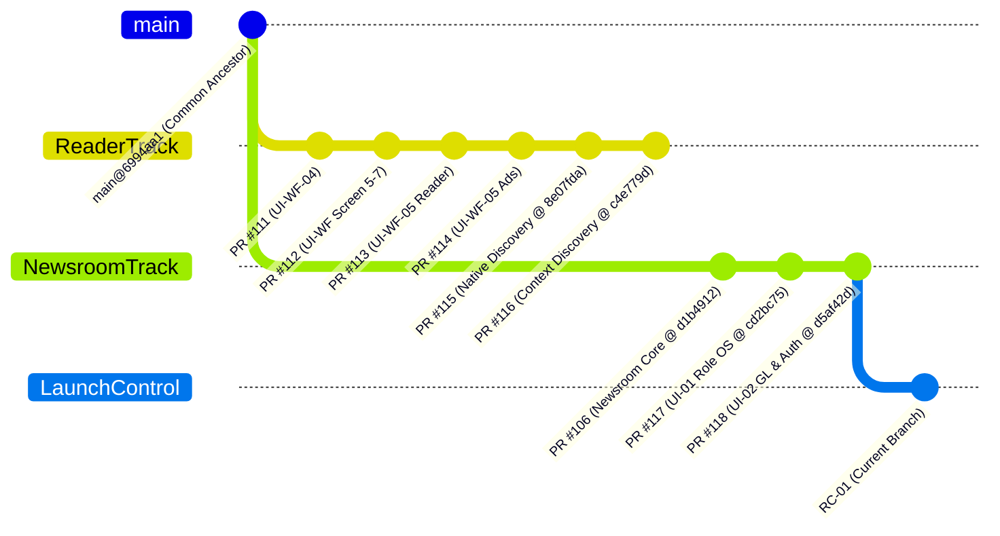
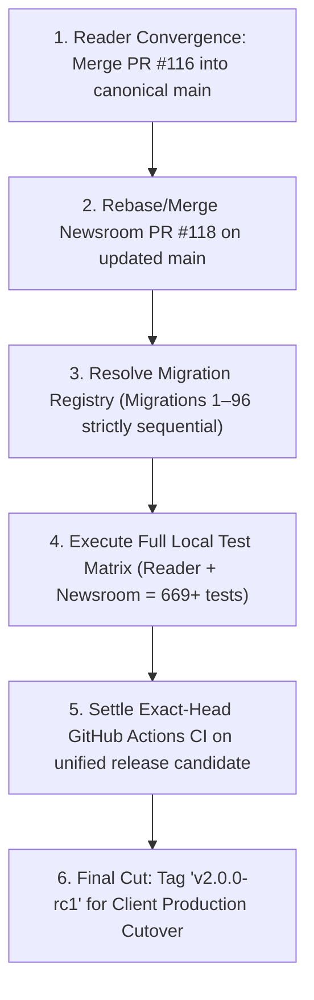

# HealthTimes 2.0 Release Topology & Lineage Audit

**Document Identifier:** `HT-MVP-RELEASE-TOPOLOGY`  
**Governing Standard:** 11-11 Tech UDPCS 1.0 — Plane 4 Operations & Release Control  
**Programme:** HealthTimes 2.0  
**Audit Date:** 2026-10-21  
**Auditor:** HealthTimes MVP Release Assurance / Client Delivery Lead  
**Classification:** `P0_RELEASE_INTEGRATION_REQUIRED`

---

## 1. Executive Summary & Core Finding

An independent, rigorous forensic audit of the `kudzimusar/htp-zw` git repository was conducted across all active, draft, and accepted branches.

### The Critical Truth:
```text
SINGLE_RELEASABLE_HEAD_EXISTS=NO
```

While each major subsystem has been built, tested, and certified with 100% green exact-head CI, **the accepted Reader subsystems and the accepted Newsroom subsystems currently live on parallel lines of development that have diverged from `main`**.

No single git commit currently contains:
- The accepted 12-screen responsive Reader UI (Screens 1–12) with native discovery and context RPCs; **AND**
- The accepted Newsroom OS with 7 Operating Domains, 12 specialized desks, First-Owner authentication, and double-entry General Ledger.

Therefore, this audit formally classifies the release state as:
```text
RELEASE_INTEGRATION_BLOCKER=P0_RELEASE_INTEGRATION_REQUIRED
```

---

## 2. Exhaustive Branch Authority Inventory

| Subsystem / Layer | Branch Name | Controlling PR | Exact Accepted Commit SHA | Status |
|---|---|---|---|---|
| **Base Main** | `main` | N/A | `6994aa18d37e2189dbc1d3f8efc76a638ee0971c` | Active Trunk |
| **Newsroom Foundation** | `feat/ht-nr-close-operational-completion` | PR `#106` | `d1b49126513fa288160db6e64c918b7a98ffbf16` | Frozen Newsroom Baseline |
| **Reader Lineage (Screens 1–12)** | `feat/ui-wf05-advertising-conformance` | PR `#114` / `#113` | `3da6bbf3223b2814cf29f7a99870d841633b8e7b` | Accepted UIM / UI-WF |
| **Native Reader Discovery** | `integration/ui-nr-native-reader-discovery` | PR `#115` | `8e07fda024f724502d7ebb424dd86a10a3f2466b` | Accepted Dual-Feed Integration |
| **Native Context Discovery** | `integration/ui-nr-native-context-discovery` | PR `#116` | `c4e779dbbc2b65232c90b4e69b74551b62f1910d` | **Accepted Reader Final Authority** |
| **Newsroom OS (7 Domains)** | `feat/ht-nr-ui01-role-operating-system-convergence` | PR `#117` | `cd2bc75dd6fcd03b9afc869bd25ccda3067bd435` | Accepted UI-01 Candidate |
| **Newsroom Hardening & GL** | `feat/ht-nr-ui02-launch-hardening-accounting-auth` | PR `#118` | `d5af42d6b7018dfd3451ac9d621482e0edf9664f` | **Accepted Newsroom Final Authority** |
| **MVP Delivery Assurance** | `release/ht-mvp-rc01-udpcs-launch-control` | Current Draft | `release/ht-mvp-rc01-udpcs-launch-control` | Active Governance Wave |

---

## 3. Git Ancestry & Divergence Graph



### Forensic Proof of Divergence:
```bash
$ git merge-base origin/integration/ui-nr-native-context-discovery origin/feat/ht-nr-ui02-launch-hardening-accounting-auth
6994aa18d37e2189dbc1d3f8efc76a638ee0971c (origin/main)
```

The merge base between the final Reader branch (PR #116) and the final Newsroom branch (PR #118) is `main` (`6994aa18`). They do not share commits beyond `main`.

---

## 4. Subsystem Distribution Across Branches

| Subsystem / Capability | Present on PR #116 (Reader)? | Present on PR #118 (Newsroom)? | Consequence |
|---|---|---|---|
| **Universal Reader UI (Screens 1–12)** | **YES (Authoritative)** | Partial (Older Phase 10 snapshot) | PR #116 is the sole authority for Reader UI |
| **Native Dual-Feed Story Discovery** | **YES (Authoritative)** | No | Reader feed mapper exists only on PR #115/116 |
| **Native Category/Author/Topic Discovery** | **YES (Authoritative)** | No | Context RPC integration exists only on PR #116 |
| **HTTPS Media Boundary Enforcement** | **YES (Authoritative)** | No | Enforced in Migration `20261020042423` on PR #116 |
| **Newsroom 7-Domain Operating System** | No | **YES (Authoritative)** | Exists only on PR #117/118 |
| **Newsroom 12 Professional Desks** | No | **YES (Authoritative)** | Exists only on PR #117/118 |
| **First Owner Parameterless Auth** | No | **YES (Authoritative)** | Deployed in Migration 93/96 on PR #118 |
| **Double-Entry General Ledger (COA/P&L/BS)** | No | **YES (Authoritative)** | Deployed in Migration 95 on PR #118 |
| **Owner Preview with 7 Role Personas** | No | **YES (Authoritative)** | Exists only on PR #117/118 |

---

## 5. Exact Safe Integration Sequence (Post-Approval)

Per Moderator instructions, **no branches are merged in this wave**. When authorized by the Moderator for the final release assembly wave, the convergence must follow this exact order:



### Detailed Integration Protocol:
1. **Merge PR #116 into `main`:**
   PR #116 brings all accepted Reader workflows, Screens 1–12, and the public context discovery functions cleanly into `main`.
2. **Merge/Rebase PR #118 onto `main`:**
   PR #118 adds the Newsroom OS, Studio routes, First Owner activation screen, and General Ledger into the unified codebase.
3. **Database Migration Verification:**
   Ensure migrations `20261020041108` and `20261020042423` (context discovery) are ordered cleanly alongside migrations `20261021020000`, `20261021030000`, `20261021040000`, and `20261021050000` (Newsroom GL & security).
4. **Unified Verification:**
   Execute `node --test tests/*.test.mjs` and verify zero regressions.
5. **Tag & Release:**
   Tag the unified commit as `v2.0.0-rc1` for client handoff.

---

## 6. Audit Conclusion & Disposition

```text
STATUS: P0_RELEASE_INTEGRATION_REQUIRED
IMPACT ON CLIENT DRY RUN: NON-BLOCKING (Owner Preview and Staging Studio fully demonstrate Newsroom OS; Reader PWA demonstrates Reader)
IMPACT ON FINAL PRODUCTION BINARY: BLOCKING (Merge required before final production deploy)
GOVERNANCE: Strict segregation maintained until authorized by Moderator
```
