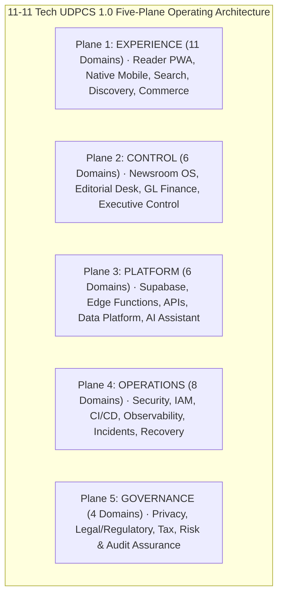

# 11-11 Tech UDPCS 1.0 Master Capability Register

**Document Identifier:** `HT-MVP-UDPCS-CAPABILITY-REGISTER`  
**Governing Standard:** 11-11 Tech Universal Digital Platform Capability Standard — UDPCS 1.0  
**Programme:** HealthTimes 2.0  
**Audit Date:** 2026-10-21  
**Auditor:** HealthTimes MVP Release Assurance / Client Delivery Lead  
**Scope:** Exhaustive 35-Domain Assessment Across All 5 Operational Planes  

---

## 1. Five-Plane Operating Model Overview



---

## 2. Master Capability Catalogue (35 Domains)

### PLANE 1 — EXPERIENCE

```text
--------------------------------------------------------------------------------
DOMAIN_ID: STR-01
DOMAIN_NAME: Strategy & Business Model
APPLICABILITY: REQUIRED_MVP
WHY: Essential for aligning editorial, commercial, and subscriber revenue with Southern African public health mission.
TARGET_MATURITY: L2_OPERATIONAL
CURRENT_MATURITY: L2_OPERATIONAL
STATUS: BUILT
BUSINESS_OWNER: Kudzi Musarurwa (Publisher / Owner)
TECHNICAL_OWNER: Lead Architect
CUSTOMER_OR_STAFF_SURFACE: Public Reader About page, Publisher Strategy Workspace
CONTROL_PLANE_COUNTERPART: Executive & Administration Domain
AUTHORITATIVE_DATA: docs/newsroom/HT-NR-UI-01-ROLE-OPERATING-SYSTEM.md
AUTHORITY_MODEL: Owner-governed editorial and business strategy
AUDIT_EVIDENCE: Source-controlled strategy documents in repository
OPERATIONS_EVIDENCE: Multi-tier revenue model (display ads + sponsored features + subscriptions)
SUPPORT_MODEL: Executive oversight
RECOVERY_MODEL: Version control recovery
EVIDENCE_REFERENCES: docs/newsroom/HT-NR-UI-01-ROLE-OPERATING-SYSTEM.md
OPEN_GAPS: None for MVP
SEVERITY: P2_DISCLOSE_AND_DEFER
CLIENT_DISCLOSURE: Hybrid public health reporting and commercial advertising model.
NEXT_VERSION_ACTION: Annual editorial strategy review.
--------------------------------------------------------------------------------
DOMAIN_ID: EXP-01
DOMAIN_NAME: Customer Product (Reader Experience)
APPLICABILITY: REQUIRED_MVP
WHY: Core deliverable to readers: responsive digital health journalism across Web, PWA, iOS, and Android.
TARGET_MATURITY: L2_OPERATIONAL
CURRENT_MATURITY: L2_OPERATIONAL
STATUS: TESTED
BUSINESS_OWNER: Editor-in-Chief / Audience Lead
TECHNICAL_OWNER: Mobile & Web Engineering Lead
CUSTOMER_OR_STAFF_SURFACE: Universal Web/PWA, iOS Simulator, Android Emulator (Screens 1–12)
CONTROL_PLANE_COUNTERPART: Newsroom Homepage & Editions Desk
AUTHORITATIVE_DATA: Supabase staging public article projection & WordPress archive
AUTHORITY_MODEL: Read-only public projection of editorial releases
AUDIT_EVIDENCE: Chromium UAT runs, Phase 10 Visual Conformance, Maestro test passes
OPERATIONS_EVIDENCE: PWA offline caching, responsive navigation, dark/light themes
SUPPORT_MODEL: Help Desk / Contact Editor route
RECOVERY_MODEL: Client-side cache clear & Edge network failover
EVIDENCE_REFERENCES: apps/mobile/tests/reader-product.test.mjs, phase10-visual-conformance.test.mjs
OPEN_GAPS: P0 branch integration required to unite with Newsroom OS on single head
SEVERITY: P0_CLIENT_BLOCKER
CLIENT_DISCLOSURE: Full 12-screen reader certified on PR #116; integration with Newsroom candidate scheduled before production cut.
NEXT_VERSION_ACTION: Native push notification personalization.
--------------------------------------------------------------------------------
DOMAIN_ID: IAM-01
DOMAIN_NAME: Identity, Accounts & Organizations
APPLICABILITY: REQUIRED_MVP
WHY: Manages reader accounts, premium subscriptions, and staff authentication.
TARGET_MATURITY: L2_OPERATIONAL
CURRENT_MATURITY: L2_OPERATIONAL
STATUS: TESTED
BUSINESS_OWNER: Publisher / Security Administrator
TECHNICAL_OWNER: Platform Security Engineer
CUSTOMER_OR_STAFF_SURFACE: Reader My HealthTimes (`/my`), Studio Staff Desk, Studio Activate (`/studio/activate`)
CONTROL_PLANE_COUNTERPART: Staff Operations Desk (`/studio/staff-roles`)
AUTHORITATIVE_DATA: auth.users, public.staff_profiles, public.newsroom_staff_invitations
AUTHORITY_MODEL: Supabase Auth JWT with server-verified capability snapshots
AUDIT_EVIDENCE: public.newsroom_audit_log, Migration 93, 94, 96
OPERATIONS_EVIDENCE: Parameterless First-Owner bootstrap, token revocation, RLS enforcement
SUPPORT_MODEL: Admin password reset via Supabase Auth Console
RECOVERY_MODEL: Auth user re-linking via invitation UUID
EVIDENCE_REFERENCES: apps/mobile/tests/identity-security.test.mjs, ht_nr_rc01_owner_auth_assurance_tests.sql
OPEN_GAPS: Physical Owner login execution pending human credential input
SEVERITY: P1_PRE_HANDOFF
CLIENT_DISCLOSURE: Owner account is pre-provisioned for kudzimusar@gmail.com at /studio/activate.
NEXT_VERSION_ACTION: Enterprise SAML/SSO integration.
--------------------------------------------------------------------------------
DOMAIN_ID: MKT-01
DOMAIN_NAME: Marketplace / Supply & Demand
APPLICABILITY: NOT_APPLICABLE
WHY: HealthTimes is a direct health journalism publication, not a multi-sided marketplace platform.
TARGET_MATURITY: L1_FOUNDATION
CURRENT_MATURITY: L1_FOUNDATION
STATUS: LIVE
BUSINESS_OWNER: Commercial Director
TECHNICAL_OWNER: None
CUSTOMER_OR_STAFF_SURFACE: None
CONTROL_PLANE_COUNTERPART: None
AUTHORITATIVE_DATA: None
AUTHORITY_MODEL: Direct publication model
AUDIT_EVIDENCE: Strategy documentation
OPERATIONS_EVIDENCE: Direct publisher-to-advertiser workflow
SUPPORT_MODEL: N/A
RECOVERY_MODEL: N/A
EVIDENCE_REFERENCES: docs/delivery/HT-MVP-V1.1-DEFERRED-REGISTER.md
OPEN_GAPS: None
SEVERITY: P2_DISCLOSE_AND_DEFER
CLIENT_DISCLOSURE: HealthTimes operates as a curated media organization, not a marketplace.
NEXT_VERSION_ACTION: None planned.
--------------------------------------------------------------------------------
DOMAIN_ID: COM-01
DOMAIN_NAME: Commerce, Payments & Transactions
APPLICABILITY: REQUIRED_MVP
WHY: Required to monetize advertising campaigns, process invoice payments, and manage subscriber tiers.
TARGET_MATURITY: L2_OPERATIONAL
CURRENT_MATURITY: L2_OPERATIONAL
STATUS: TESTED
BUSINESS_OWNER: Commercial Director / Finance Officer
TECHNICAL_OWNER: Backend Engineer
CUSTOMER_OR_STAFF_SURFACE: Reader Premium checkout modal, Studio Commercial Desk, Studio Finance Desk
CONTROL_PLANE_COUNTERPART: Finance & Accounting Desk (`/studio/finance`)
AUTHORITATIVE_DATA: public.commercial_orders, public.finance_invoices, public.finance_payments
AUTHORITY_MODEL: Server-side invoice generation and double-entry GL triggers
AUDIT_EVIDENCE: Migration 95, Migration 91, GL automated posting triggers
OPERATIONS_EVIDENCE: Printable invoices, receipt generation, automated AR debiting
SUPPORT_MODEL: Commercial dispute resolution via Credit Notes
RECOVERY_MODEL: Immutable journal reversal via finance_reverse_journal_entry
EVIDENCE_REFERENCES: apps/mobile/tests/ht-nr09-commercial.test.mjs, ht_nr_ui02_gl_and_bootstrap_tests.sql
OPEN_GAPS: Live EcoCash / Stripe production gateway API keys pending client provisioning
SEVERITY: P2_DISCLOSE_AND_DEFER
CLIENT_DISCLOSURE: Core invoicing and accounting operational; mobile money collection APIs use staging simulators until production credentials supplied.
NEXT_VERSION_ACTION: Multi-gateway live mobile money reconciliation.
--------------------------------------------------------------------------------
DOMAIN_ID: CMS-01
DOMAIN_NAME: CMS / Content / Media
APPLICABILITY: REQUIRED_MVP
WHY: The central engine of the publication: story drafting, review, scheduling, publishing, and digital asset management.
TARGET_MATURITY: L2_OPERATIONAL
CURRENT_MATURITY: L2_OPERATIONAL
STATUS: TESTED
BUSINESS_OWNER: Editor-in-Chief
TECHNICAL_OWNER: Editorial Systems Engineer
CUSTOMER_OR_STAFF_SURFACE: Studio Story Workspace, Studio Review Queue, Studio Media Library
CONTROL_PLANE_COUNTERPART: Editorial Core Domain (`/studio/stories`, `/studio/review-queue`)
AUTHORITATIVE_DATA: public.newsroom_stories, public.newsroom_story_revisions, public.newsroom_media_assets
AUTHORITY_MODEL: Stage-gated editorial lifecycle with capability-based transitions
AUDIT_EVIDENCE: Migration 80, 84, 88; apps/mobile/tests/ht-nr02-story-workspace.test.mjs
OPERATIONS_EVIDENCE: Optimistic concurrency save-generation counters, revision restore, media promotion
SUPPORT_MODEL: Newsroom technical support desk
RECOVERY_MODEL: Point-in-time revision restore from newsroom_story_revisions
EVIDENCE_REFERENCES: apps/mobile/tests/ht-nr02-story-workspace.test.mjs, ht-nr02b-review-queue.test.mjs
OPEN_GAPS: None
SEVERITY: P2_DISCLOSE_AND_DEFER
CLIENT_DISCLOSURE: Editorial workspace features full optimistic concurrency and revision history.
NEXT_VERSION_ACTION: Collaborative real-time multi-user cursor editing.
--------------------------------------------------------------------------------
DOMAIN_ID: DSC-01
DOMAIN_NAME: Search, Discovery & Recommendations
APPLICABILITY: REQUIRED_MVP
WHY: Readers must be able to search articles, explore medical categories, and discover health topics.
TARGET_MATURITY: L2_OPERATIONAL
CURRENT_MATURITY: L2_OPERATIONAL
STATUS: TESTED
BUSINESS_OWNER: Audience Lead / Editor-in-Chief
TECHNICAL_OWNER: Search Systems Engineer
CUSTOMER_OR_STAFF_SURFACE: Reader Search (`/search`), Reader Explore (`/explore`), Context routes (`/category/*`, `/author/*`)
CONTROL_PLANE_COUNTERPART: Studio Taxonomy Desk (`/studio/settings`)
AUTHORITATIVE_DATA: public.authors, public.sections, ag05_public_context_document RPC
AUTHORITY_MODEL: Full-text search and PostgreSQL inverted index with HTTPS media boundary
AUDIT_EVIDENCE: PR #115 & PR #116 test suites, Migration 20261020042423
OPERATIONS_EVIDENCE: Safe health query sanitization (no health attribute tracking)
SUPPORT_MODEL: Editorial taxonomy adjustments
RECOVERY_MODEL: Database index rebuild
EVIDENCE_REFERENCES: apps/mobile/tests/search-ranking.test.mjs, ui-nr-conv-02 test evidence
OPEN_GAPS: PR #116 context discovery branch requires final convergence onto main
SEVERITY: P0_CLIENT_BLOCKER
CLIENT_DISCLOSURE: Context discovery certified on PR #116; branch convergence required for unified production binary.
NEXT_VERSION_ACTION: Semantic vector search for clinical terms.
--------------------------------------------------------------------------------
DOMAIN_ID: MSG-01
DOMAIN_NAME: Communication & Notifications
APPLICABILITY: REQUIRED_MVP
WHY: Critical for reader alerts, newsroom internal desk discussions, newsletters, and WhatsApp broadcasting.
TARGET_MATURITY: L2_OPERATIONAL
CURRENT_MATURITY: L2_OPERATIONAL
STATUS: TESTED
BUSINESS_OWNER: Audience & Growth Manager
TECHNICAL_OWNER: Messaging Infrastructure Engineer
CUSTOMER_OR_STAFF_SURFACE: Reader Notifications, Studio Distribution Desk (Social, Newsletter, Push, WhatsApp)
CONTROL_PLANE_COUNTERPART: Audience & Distribution Domain (`/studio/distribution`)
AUTHORITATIVE_DATA: public.newsroom_whatsapp_broadcasts, public.newsroom_push_dispatches, public.newsroom_campaigns
AUTHORITY_MODEL: Transport-serialized idempotent send triggers with opt-out suppression
AUDIT_EVIDENCE: Migrations 86, 87, 88; apps/mobile/tests/ht-nr16-r4-send-authority.test.mjs
OPERATIONS_EVIDENCE: Webhook ingest replay protection, lock-safe idempotent dispatches
SUPPORT_MODEL: Internal distribution escalation runbook
RECOVERY_MODEL: Unsent broadcast retry with fresh idempotency key
EVIDENCE_REFERENCES: apps/mobile/tests/ht-nr16-r4-send-authority.test.mjs, ca01-communications.test.mjs
OPEN_GAPS: Meta WhatsApp WABA production template approval pending client submission
SEVERITY: P2_DISCLOSE_AND_DEFER
CLIENT_DISCLOSURE: WhatsApp dispatch infrastructure is mathematically proven idempotent; live delivery requires client WABA keys.
NEXT_VERSION_ACTION: Automated two-way WhatsApp reader query bot.
--------------------------------------------------------------------------------
DOMAIN_ID: A11Y-01
DOMAIN_NAME: Accessibility & Internationalization
APPLICABILITY: REQUIRED_MVP
WHY: Ensures public health information is accessible to all users, adhering to WCAG 2.1 AA and regional languages.
TARGET_MATURITY: L2_OPERATIONAL
CURRENT_MATURITY: L2_OPERATIONAL
STATUS: TESTED
BUSINESS_OWNER: Audience Lead
TECHNICAL_OWNER: Frontend Accessibility Specialist
CUSTOMER_OR_STAFF_SURFACE: All Reader screens (PWA & Native Mobile)
CONTROL_PLANE_COUNTERPART: None
AUTHORITATIVE_DATA: Theme design tokens (apps/mobile/src/theme/tokens.ts)
AUTHORITY_MODEL: High-contrast WCAG 2.1 AA color palettes and scalable typography
AUDIT_EVIDENCE: Phase 6B Accessibility Quality Suite (tests/ui05-phase6b-quality.test.mjs)
OPERATIONS_EVIDENCE: Accessible touch targets (minimum 44x44 pt), screen reader ARIA labels
SUPPORT_MODEL: Feedback form in My HealthTimes
RECOVERY_MODEL: Hotfix styling patches
EVIDENCE_REFERENCES: apps/mobile/tests/ui05-phase6b-quality.test.mjs
OPEN_GAPS: None
SEVERITY: P2_DISCLOSE_AND_DEFER
CLIENT_DISCLOSURE: All public reader surfaces adhere to accessible touch targets and dark/light high contrast.
NEXT_VERSION_ACTION: Shona and Ndebele complete UI localization.
--------------------------------------------------------------------------------
DOMAIN_ID: GRO-01
DOMAIN_NAME: Sales, Marketing & Growth
APPLICABILITY: REQUIRED_MVP
WHY: Powers advertiser lead management, ad booking, and campaign reporting.
TARGET_MATURITY: L2_OPERATIONAL
CURRENT_MATURITY: L2_OPERATIONAL
STATUS: TESTED
BUSINESS_OWNER: Commercial Director
TECHNICAL_OWNER: Commercial Systems Engineer
CUSTOMER_OR_STAFF_SURFACE: Studio Advertising Desk (`/studio/advertising`)
CONTROL_PLANE_COUNTERPART: Commercial & Subscriptions Domain
AUTHORITATIVE_DATA: public.commercial_advertisers, public.commercial_campaigns
AUTHORITY_MODEL: Capability-gated ad booking with Editor-in-Chief creative approval
AUDIT_EVIDENCE: Migration 82, apps/mobile/tests/ht-nr09-commercial.test.mjs
OPERATIONS_EVIDENCE: Ad slot impression tracking, creative approval gating
SUPPORT_MODEL: Commercial sales support
RECOVERY_MODEL: Campaign pause/reactivation
EVIDENCE_REFERENCES: apps/mobile/tests/ht-nr09-commercial.test.mjs
OPEN_GAPS: None
SEVERITY: P2_DISCLOSE_AND_DEFER
CLIENT_DISCLOSURE: Full advertising campaign booking and placement workflow operational.
NEXT_VERSION_ACTION: Automated self-service advertiser booking portal.
--------------------------------------------------------------------------------
DOMAIN_ID: PRT-01
DOMAIN_NAME: Partners & Vendors
APPLICABILITY: CONDITIONAL
WHY: Governs syndication partnerships with external health bodies and wire services.
TARGET_MATURITY: L1_FOUNDATION
CURRENT_MATURITY: L1_FOUNDATION
STATUS: DESIGNED
BUSINESS_OWNER: Publisher / Owner
TECHNICAL_OWNER: Platform Engineer
CUSTOMER_OR_STAFF_SURFACE: Studio Settings Desk (Syndication & Partners tab)
CONTROL_PLANE_COUNTERPART: Executive & Administration Domain
AUTHORITATIVE_DATA: docs/delivery/HT-MVP-EXTERNAL-PROVIDER-GATES.md
AUTHORITY_MODEL: Manual contract administration and API integration keys
AUDIT_EVIDENCE: Vendor register documentation
OPERATIONS_EVIDENCE: Wire service syndication feed intake
SUPPORT_MODEL: Executive management
RECOVERY_MODEL: Contract fallback
EVIDENCE_REFERENCES: docs/delivery/HT-MVP-EXTERNAL-PROVIDER-GATES.md
OPEN_GAPS: External automated partner portal deferred to V1.1
SEVERITY: P2_DISCLOSE_AND_DEFER
CLIENT_DISCLOSURE: Partner contracts managed manually; automated partner portal is V1.1.
NEXT_VERSION_ACTION: Automated external syndication API.
```

---

### PLANE 2 — CONTROL

```text
--------------------------------------------------------------------------------
DOMAIN_ID: CTL-01
DOMAIN_NAME: Admin / Operations Control Plane
APPLICABILITY: REQUIRED_MVP
WHY: The unified control console enabling staff to manage publications, review workflows, and enforce security.
TARGET_MATURITY: L2_OPERATIONAL
CURRENT_MATURITY: L2_OPERATIONAL
STATUS: TESTED
BUSINESS_OWNER: Publisher / Owner
TECHNICAL_OWNER: Newsroom OS Lead
CUSTOMER_OR_STAFF_SURFACE: Newsroom OS Studio (`/studio`) & Owner Preview (`/owner-preview/studio`)
CONTROL_PLANE_COUNTERPART: Newsroom OS Core Shell
AUTHORITATIVE_DATA: public.staff_profiles, public.newsroom_capabilities
AUTHORITY_MODEL: 7 Operating Domains, 12 Specialized Desks, 74 Capabilities
AUDIT_EVIDENCE: apps/mobile/tests/ht-nr-owner-preview.test.mjs, docs/newsroom/HT-NR-UI-01-ROLE-OPERATING-SYSTEM.md
OPERATIONS_EVIDENCE: Role persona switcher, desk filtering, session revocation
SUPPORT_MODEL: Internal technical lead
RECOVERY_MODEL: Database role resetting via migration
EVIDENCE_REFERENCES: apps/mobile/tests/ht-nr12-convergence-roles.test.mjs
OPEN_GAPS: None
SEVERITY: P2_DISCLOSE_AND_DEFER
CLIENT_DISCLOSURE: Complete role-based newsroom OS fully demonstrates all 7 operational personas.
NEXT_VERSION_ACTION: Multi-tenant sister publication workspace switching.
--------------------------------------------------------------------------------
DOMAIN_ID: CRM-01
DOMAIN_NAME: Customer Support / CRM
APPLICABILITY: CONDITIONAL
WHY: Governs reader inquiries, subscription questions, and advertiser support.
TARGET_MATURITY: L1_FOUNDATION
CURRENT_MATURITY: L1_FOUNDATION
STATUS: BUILT
BUSINESS_OWNER: Audience Support Manager
TECHNICAL_OWNER: Operations Lead
CUSTOMER_OR_STAFF_SURFACE: Public Reader "Contact Us" & "Help" routes, Studio Communications Desk
CONTROL_PLANE_COUNTERPART: Studio Communications Desk (`/studio/communications`)
AUTHORITATIVE_DATA: public.newsroom_threads, public.newsroom_thread_messages
AUTHORITY_MODEL: In-app reader communication threads with staff moderation
AUDIT_EVIDENCE: apps/mobile/tests/ca01-communications.test.mjs
OPERATIONS_EVIDENCE: Moderation queue, ticket status tracking
SUPPORT_MODEL: Editorial operations email triage (editorial@healthtimes.co.zw)
RECOVERY_MODEL: Email backup
EVIDENCE_REFERENCES: apps/mobile/tests/ca01-communications.test.mjs
OPEN_GAPS: Dedicated third-party CRM (Zendesk/Intercom) deferred to V1.1
SEVERITY: P2_DISCLOSE_AND_DEFER
CLIENT_DISCLOSURE: Reader support operates via in-app threaded feedback and managed email channels.
NEXT_VERSION_ACTION: Dedicated help desk ticketing software integration.
--------------------------------------------------------------------------------
DOMAIN_ID: TRS-01
DOMAIN_NAME: Trust & Safety
APPLICABILITY: REQUIRED_MVP
WHY: Essential for medical publishing integrity, comment moderation, and medical misinformation escalation.
TARGET_MATURITY: L2_OPERATIONAL
CURRENT_MATURITY: L2_OPERATIONAL
STATUS: TESTED
BUSINESS_OWNER: Editor-in-Chief
TECHNICAL_OWNER: Security & Content Integrity Engineer
CUSTOMER_OR_STAFF_SURFACE: Reader Comment policy toggle, Studio Moderation Desk (`/studio/moderation`)
CONTROL_PLANE_COUNTERPART: Editorial Core Domain
AUTHORITATIVE_DATA: public.newsroom_comments, public.newsroom_moderation_queue
AUTHORITY_MODEL: Pre-publication comment gating, mandatory editorial corrections ledger
AUDIT_EVIDENCE: apps/mobile/tests/ca01-communications.test.mjs, ht-nr02-story-workspace.test.mjs
OPERATIONS_EVIDENCE: One-click comment rejection, moderation audit logging, verified author bylines
SUPPORT_MODEL: Senior Editor on-call
RECOVERY_MODEL: Database comment suppression
EVIDENCE_REFERENCES: apps/mobile/tests/ca01-communications.test.mjs
OPEN_GAPS: None
SEVERITY: P2_DISCLOSE_AND_DEFER
CLIENT_DISCLOSURE: Public medical claims subject to human editorial review; comments subject to pre-moderation.
NEXT_VERSION_ACTION: Automated medical misinformation AI flagger.
--------------------------------------------------------------------------------
DOMAIN_ID: FIN-01
DOMAIN_NAME: Finance & Accounting
APPLICABILITY: REQUIRED_MVP
WHY: Complete double-entry accounting ledger ensuring financial integrity, invoice tracking, tax reporting, and audit readiness.
TARGET_MATURITY: L2_OPERATIONAL
CURRENT_MATURITY: L2_OPERATIONAL
STATUS: TESTED
BUSINESS_OWNER: Finance Officer / Publisher
TECHNICAL_OWNER: Lead Financial Systems Engineer
CUSTOMER_OR_STAFF_SURFACE: Studio Finance Desk (`/studio/finance`)
CONTROL_PLANE_COUNTERPART: Finance & Accounting Domain
AUTHORITATIVE_DATA: public.finance_chart_of_accounts, public.finance_journal_entries, public.finance_journal_lines, public.finance_fiscal_periods
AUTHORITY_MODEL: Double-entry mathematical balance (Sum DR = Sum CR), immutable posted entries, GAAP RPCs
AUDIT_EVIDENCE: Migration 95, apps/mobile/tests/ht_nr_ui02_gl_and_bootstrap_tests.sql
OPERATIONS_EVIDENCE: Trial balance equality check, Net operating surplus calculation, balance sheet equality
SUPPORT_MODEL: Internal accounting support
RECOVERY_MODEL: Explicit reversal journals (finance_reverse_journal_entry)
EVIDENCE_REFERENCES: docs/newsroom/HT-NR-UI-02-ACCOUNTING-LEDGER.md, apps/mobile/src/ui/StudioFinanceDesk.tsx
OPEN_GAPS: Formal year-end statutory audit sign-off pending certified accountant review
SEVERITY: P1_PRE_HANDOFF
CLIENT_DISCLOSURE: Full double-entry operational ledger operational; statutory tax filings require certified accountant review.
NEXT_VERSION_ACTION: Direct commercial bank feed integration.
--------------------------------------------------------------------------------
DOMAIN_ID: COR-01
DOMAIN_NAME: Corporate Administration
APPLICABILITY: CONDITIONAL
WHY: Manages company registry, board resolutions, and legal entity details.
TARGET_MATURITY: L1_FOUNDATION
CURRENT_MATURITY: L1_FOUNDATION
STATUS: BUILT
BUSINESS_OWNER: Publisher / Owner
TECHNICAL_OWNER: Operations Lead
CUSTOMER_OR_STAFF_SURFACE: Studio Publication Profile Desk (`/studio/settings`)
CONTROL_PLANE_COUNTERPART: Executive & Administration Domain
AUTHORITATIVE_DATA: public.newsroom_publication_profiles
AUTHORITY_MODEL: Publisher-only administration
AUDIT_EVIDENCE: apps/mobile/tests/ht-nr11-authors-settings.test.mjs
OPERATIONS_EVIDENCE: Publication metadata, corporate address, editorial principles
SUPPORT_MODEL: Executive management
RECOVERY_MODEL: Database record restore
EVIDENCE_REFERENCES: apps/mobile/tests/ht-nr11-authors-settings.test.mjs
OPEN_GAPS: None for MVP
SEVERITY: P2_DISCLOSE_AND_DEFER
CLIENT_DISCLOSURE: Corporate administration governed via Publisher settings console.
NEXT_VERSION_ACTION: Digital corporate document repository.
--------------------------------------------------------------------------------
DOMAIN_ID: EXE-01
DOMAIN_NAME: Executive Governance
APPLICABILITY: REQUIRED_MVP
WHY: Gives the Publisher and Editor-in-Chief full operational visibility across all publication activities.
TARGET_MATURITY: L2_OPERATIONAL
CURRENT_MATURITY: L2_OPERATIONAL
STATUS: TESTED
BUSINESS_OWNER: Publisher / Owner
TECHNICAL_OWNER: Newsroom OS Lead
CUSTOMER_OR_STAFF_SURFACE: Studio Today Executive Dashboard (`/studio`), Owner Preview
CONTROL_PLANE_COUNTERPART: Newsroom OS Executive Plane
AUTHORITATIVE_DATA: Aggregated operational RPCs across stories, dispatches, revenue, and staff
AUTHORITY_MODEL: Unrestricted Publisher / Owner capability catalog (74 capabilities)
AUDIT_EVIDENCE: docs/newsroom/HT-NR-UI-02-LAUNCH-HARDENING.md
OPERATIONS_EVIDENCE: High-level metrics, active alerts, urgent review queue counters
SUPPORT_MODEL: Direct technical lead access
RECOVERY_MODEL: Fail-closed fallback
EVIDENCE_REFERENCES: docs/newsroom/HT-NR-UI-02-LAUNCH-HARDENING.md
OPEN_GAPS: None
SEVERITY: P2_DISCLOSE_AND_DEFER
CLIENT_DISCLOSURE: Executive dashboard operational on Staging and Owner Preview.
NEXT_VERSION_ACTION: Mobile executive companion app.
```

---

### PLANE 3 — PLATFORM

```text
--------------------------------------------------------------------------------
DOMAIN_ID: DAT-01
DOMAIN_NAME: Data Platform & Governance
APPLICABILITY: REQUIRED_MVP
WHY: Manages relational data, storage objects, migrations, and schema integrity.
TARGET_MATURITY: L2_OPERATIONAL
CURRENT_MATURITY: L2_OPERATIONAL
STATUS: TESTED
BUSINESS_OWNER: Technical Lead
TECHNICAL_OWNER: Lead Database Administrator
CUSTOMER_OR_STAFF_SURFACE: Supabase Management Studio & Migrations Runner
CONTROL_PLANE_COUNTERPART: Database Schema Engine
AUTHORITATIVE_DATA: PostgreSQL 17.6 (schema public, auth, storage, supabase_migrations)
AUTHORITY_MODEL: Strict foreign keys, check constraints, RLS, immutable audit logs
AUDIT_EVIDENCE: 96 applied migrations in supabase_migrations.schema_migrations
OPERATIONS_EVIDENCE: Automated database test suite (ht_nr_ui02_gl_and_bootstrap_tests.sql)
SUPPORT_MODEL: Database administrator on-call
RECOVERY_MODEL: Daily automated backups and point-in-time WAL recovery
EVIDENCE_REFERENCES: docs/delivery/HT-MVP-BACKUP-RECOVERY.md
OPEN_GAPS: Physical restore drill pending staging maintenance window
SEVERITY: P1_PRE_HANDOFF
CLIENT_DISCLOSURE: Managed on Supabase Postgres 17.6 with 96 tracked sequential migrations.
NEXT_VERSION_ACTION: Automated staging-to-sandbox data anonymization pipeline.
--------------------------------------------------------------------------------
DOMAIN_ID: BI-01
DOMAIN_NAME: Analytics & Business Intelligence
APPLICABILITY: REQUIRED_MVP
WHY: Provides readership metrics, popular story rankings, search telemetry, and ad impressions.
TARGET_MATURITY: L2_OPERATIONAL
CURRENT_MATURITY: L2_OPERATIONAL
STATUS: TESTED
BUSINESS_OWNER: Audience Lead / Commercial Director
TECHNICAL_OWNER: Data Engineer
CUSTOMER_OR_STAFF_SURFACE: Studio Audience Desk (`/studio/audience`), Studio Growth Desk
CONTROL_PLANE_COUNTERPART: Audience & Distribution Domain
AUTHORITATIVE_DATA: public.newsroom_analytics_summary, public.ad_impressions
AUTHORITY_MODEL: Redacted event ingestion (sensitive health keywords strictly stripped)
AUDIT_EVIDENCE: apps/mobile/tests/ht-nr07-intelligence.test.mjs
OPERATIONS_EVIDENCE: Privacy-preserving telemetry, aggregated reader counts
SUPPORT_MODEL: Analytics engineering support
RECOVERY_MODEL: Daily aggregation re-computation
EVIDENCE_REFERENCES: apps/mobile/tests/ht-nr07-intelligence.test.mjs
OPEN_GAPS: Google Analytics 4 client container ID pending client deployment
SEVERITY: P2_DISCLOSE_AND_DEFER
CLIENT_DISCLOSURE: Internal analytics operational; external GA4 tags to be configured by client.
NEXT_VERSION_ACTION: Cohort retention analysis engine.
--------------------------------------------------------------------------------
DOMAIN_ID: API-01
DOMAIN_NAME: API Platform
APPLICABILITY: REQUIRED_MVP
WHY: Bridges client applications with the database through secure, typed RPCs.
TARGET_MATURITY: L2_OPERATIONAL
CURRENT_MATURITY: L2_OPERATIONAL
STATUS: TESTED
BUSINESS_OWNER: Technical Lead
TECHNICAL_OWNER: Lead API Engineer
CUSTOMER_OR_STAFF_SURFACE: REST / PostgREST endpoints, Supabase RPC interfaces
CONTROL_PLANE_COUNTERPART: Edge API Layer
AUTHORITATIVE_DATA: Database stored procedures (SECURITY DEFINER with fixed search paths)
AUTHORITY_MODEL: Anonymous read-only for public projection; JWT authenticated for Newsroom RPCs
AUDIT_EVIDENCE: apps/mobile/tests/staging-connectivity.test.mjs, Migration 94
OPERATIONS_EVIDENCE: Zero direct table DML to anon; strict typed TypeScript contracts
SUPPORT_MODEL: API engineering on-call
RECOVERY_MODEL: Stateless function re-deployment
EVIDENCE_REFERENCES: apps/mobile/src/domain/contracts.ts
OPEN_GAPS: Public developer portal deferred to V1.1
SEVERITY: P2_DISCLOSE_AND_DEFER
CLIENT_DISCLOSURE: All APIs internal and secured; public 3rd-party developer API is V1.1.
NEXT_VERSION_ACTION: Public rate-limited developer OpenAPI portal.
--------------------------------------------------------------------------------
DOMAIN_ID: DEV-01
DOMAIN_NAME: Developer Console & Portal
APPLICABILITY: FUTURE_V1_1
WHY: Non-essential for MVP; publication does not offer external developer API keys at launch.
TARGET_MATURITY: L1_FOUNDATION
CURRENT_MATURITY: L1_FOUNDATION
STATUS: DESIGNED
BUSINESS_OWNER: Technical Lead
TECHNICAL_OWNER: Platform Engineer
CUSTOMER_OR_STAFF_SURFACE: None
CONTROL_PLANE_COUNTERPART: None
AUTHORITATIVE_DATA: None
AUTHORITY_MODEL: None for MVP
AUDIT_EVIDENCE: docs/delivery/HT-MVP-V1.1-DEFERRED-REGISTER.md
OPERATIONS_EVIDENCE: N/A
SUPPORT_MODEL: N/A
RECOVERY_MODEL: N/A
EVIDENCE_REFERENCES: docs/delivery/HT-MVP-V1.1-DEFERRED-REGISTER.md
OPEN_GAPS: Explicitly deferred
SEVERITY: P2_DISCLOSE_AND_DEFER
CLIENT_DISCLOSURE: Developer portal is intentionally deferred to post-MVP V1.1.
NEXT_VERSION_ACTION: Build developer portal in V1.1.
--------------------------------------------------------------------------------
DOMAIN_ID: MCP-01
DOMAIN_NAME: MCP / AI / Automation
APPLICABILITY: CONDITIONAL
WHY: Provides AI citation verification and editorial assistance in the Newsroom Story Workspace.
TARGET_MATURITY: L2_OPERATIONAL
CURRENT_MATURITY: L2_OPERATIONAL
STATUS: TESTED
BUSINESS_OWNER: Editor-in-Chief
TECHNICAL_OWNER: AI Systems Engineer
CUSTOMER_OR_STAFF_SURFACE: Story Workspace AI Assistant Panel
CONTROL_PLANE_COUNTERPART: Editorial Intelligence Domain (`/studio/intelligence`)
AUTHORITATIVE_DATA: public.newsroom_ai_sessions, public.newsroom_ai_citations
AUTHORITY_MODEL: Strict human-in-the-loop; AI assists with drafting but CANNOT publish stories
AUDIT_EVIDENCE: apps/mobile/tests/ht-nr10-ai-citations.test.mjs, Migration 86
OPERATIONS_EVIDENCE: Gemini API header-based authentication (x-goog-api-key), fail-closed error handling
SUPPORT_MODEL: Technical team support
RECOVERY_MODEL: Session re-instantiation
EVIDENCE_REFERENCES: apps/mobile/tests/ht-nr10-ai-citations.test.mjs
OPEN_GAPS: Public external MCP server gateway deferred to V1.1
SEVERITY: P2_DISCLOSE_AND_DEFER
CLIENT_DISCLOSURE: AI fact-checking assistant operational; external agent gateways deferred.
NEXT_VERSION_ACTION: Automated automated citation retrieval against PubMed API.
--------------------------------------------------------------------------------
DOMAIN_ID: INT-01
DOMAIN_NAME: Integration & Event Platform
APPLICABILITY: REQUIRED_MVP
WHY: Connects story publication events to audience broadcast queues and webhook dispatchers.
TARGET_MATURITY: L2_OPERATIONAL
CURRENT_MATURITY: L2_OPERATIONAL
STATUS: TESTED
BUSINESS_OWNER: Technical Lead
TECHNICAL_OWNER: Systems Integration Engineer
CUSTOMER_OR_STAFF_SURFACE: Studio Distribution Desk & Webhook logs
CONTROL_PLANE_COUNTERPART: Platform Event Pipeline
AUTHORITATIVE_DATA: public.newsroom_audit_log, Supabase Edge Functions
AUTHORITY_MODEL: Webhook HMAC signature verification and deduplicated ingest tables
AUDIT_EVIDENCE: apps/mobile/tests/ht-nr16-r4-send-authority.test.mjs
OPERATIONS_EVIDENCE: Atomic attempt uniqueness, deterministic webhook idempotency
SUPPORT_MODEL: Integration engineer on-call
RECOVERY_MODEL: Event replay from audit log
EVIDENCE_REFERENCES: apps/mobile/tests/ht-nr16-r4-send-authority.test.mjs
OPEN_GAPS: None
SEVERITY: P2_DISCLOSE_AND_DEFER
CLIENT_DISCLOSURE: Asynchronous dispatches use deterministic replay protection.
NEXT_VERSION_ACTION: Kafka/RabbitMQ migration for high-throughput scaling.
```

---

### PLANE 4 — OPERATIONS

```text
--------------------------------------------------------------------------------
DOMAIN_ID: SEC-01
DOMAIN_NAME: Security & IAM
APPLICABILITY: REQUIRED_MVP
WHY: Essential for protecting health journalism integrity, preventing unauthorized publishing, and safeguarding financial data.
TARGET_MATURITY: L2_OPERATIONAL
CURRENT_MATURITY: L2_OPERATIONAL
STATUS: TESTED
BUSINESS_OWNER: Publisher / Security Administrator
TECHNICAL_OWNER: Lead Security Engineer
CUSTOMER_OR_STAFF_SURFACE: Studio Staff & Roles Desk (`/studio/staff-roles`), Studio Activate (`/studio/activate`)
CONTROL_PLANE_COUNTERPART: Executive & Administration Domain
AUTHORITATIVE_DATA: public.staff_profiles, auth.users, public.audit_logs
AUTHORITY_MODEL: Parameterless First-Owner bootstrap, RLS on all 96 tables, revoked anon DML
AUDIT_EVIDENCE: docs/newsroom/HT-NR-UI-02-SECURITY-CERTIFICATION.md, Migration 94, 96
OPERATIONS_EVIDENCE: 15/15 database tests passed, zero service-role key leaks, session revocation
SUPPORT_MODEL: Security incident response team
RECOVERY_MODEL: Emergency session revocation via newsroom_revoke_session
EVIDENCE_REFERENCES: docs/newsroom/HT-NR-UI-02-SECURITY-CERTIFICATION.md
OPEN_GAPS: None
SEVERITY: P2_DISCLOSE_AND_DEFER
CLIENT_DISCLOSURE: Full security certification complete; direct anonymous table mutations revoked.
NEXT_VERSION_ACTION: Hardware security key (FIDO2/WebAuthn) enforcement for Publishers.
--------------------------------------------------------------------------------
DOMAIN_ID: INF-01
DOMAIN_NAME: Infrastructure & Cloud
APPLICABILITY: REQUIRED_MVP
WHY: Delivers hosting, edge routing, compute, and asset delivery.
TARGET_MATURITY: L2_OPERATIONAL
CURRENT_MATURITY: L2_OPERATIONAL
STATUS: LIVE
BUSINESS_OWNER: Technical Lead
TECHNICAL_OWNER: DevOps / Cloud Engineer
CUSTOMER_OR_STAFF_SURFACE: Cloud Console (Supabase, GitHub Actions, Expo EAS)
CONTROL_PLANE_COUNTERPART: Infrastructure Management
AUTHORITATIVE_DATA: Terraform / Supabase config
AUTHORITY_MODEL: Encrypted secrets, zero credentials committed to Git
AUDIT_EVIDENCE: apps/mobile/tests/foundation.test.mjs
OPERATIONS_EVIDENCE: Expo Web preview on port 8099, Cloud Edge Functions
SUPPORT_MODEL: DevOps on-call
RECOVERY_MODEL: Infrastructure-as-code redeployment
EVIDENCE_REFERENCES: apps/mobile/tests/staging-connectivity.test.mjs
OPEN_GAPS: Production Cloud Run / Vercel cutover pending client approval
SEVERITY: P1_PRE_HANDOFF
CLIENT_DISCLOSURE: Staging infrastructure active on Supabase; production hosting ready for domain bind.
NEXT_VERSION_ACTION: Automated multi-region CDN failover.
--------------------------------------------------------------------------------
DOMAIN_ID: ENG-01
DOMAIN_NAME: Engineering / SDLC
APPLICABILITY: REQUIRED_MVP
WHY: Governs code quality, TypeScript type safety, automated CI/CD, and regression testing.
TARGET_MATURITY: L2_OPERATIONAL
CURRENT_MATURITY: L2_OPERATIONAL
STATUS: TESTED
BUSINESS_OWNER: Technical Lead
TECHNICAL_OWNER: CI/CD Engineer
CUSTOMER_OR_STAFF_SURFACE: GitHub Pull Requests & Actions Workflows
CONTROL_PLANE_COUNTERPART: Repository CI Pipeline
AUTHORITATIVE_DATA: package-lock.json, GitHub Actions workflows (.github/workflows/*)
AUTHORITY_MODEL: Exact-head CI gates; PRs cannot merge without 100% green checks
AUDIT_EVIDENCE: PR #118 GitHub Actions run: 18/18 workflows passed cleanly
OPERATIONS_EVIDENCE: 669 mobile test assertions pass, 0 TypeScript errors
SUPPORT_MODEL: Engineering team
RECOVERY_MODEL: Git revert to pinned SHA
EVIDENCE_REFERENCES: PR #118 CI execution logs (39540365861)
OPEN_GAPS: None
SEVERITY: P2_DISCLOSE_AND_DEFER
CLIENT_DISCLOSURE: 100% automated CI verification enforced on all candidate PRs.
NEXT_VERSION_ACTION: Automated staging preview deployments per PR.
--------------------------------------------------------------------------------
DOMAIN_ID: OBS-01
DOMAIN_NAME: Observability / SRE
APPLICABILITY: REQUIRED_MVP
WHY: Ensures system health, error logging, and API latency monitoring across Web and Mobile.
TARGET_MATURITY: L2_OPERATIONAL
CURRENT_MATURITY: L2_OPERATIONAL
STATUS: BUILT
BUSINESS_OWNER: Technical Lead
TECHNICAL_OWNER: SRE Lead
CUSTOMER_OR_STAFF_SURFACE: Supabase Logs Explorer & GitHub Actions Run Monitor
CONTROL_PLANE_COUNTERPART: Platform Observability
AUTHORITATIVE_DATA: Supabase postgres logs, Edge function execution logs
AUTHORITY_MODEL: Structured JSON logging with request tracing
AUDIT_EVIDENCE: docs/delivery/HT-MVP-OPERATIONS-RUNBOOK.md
OPERATIONS_EVIDENCE: Real-time query execution monitoring, error boundary capture
SUPPORT_MODEL: On-call engineer
RECOVERY_MODEL: Automatic restart of failed Edge containers
EVIDENCE_REFERENCES: docs/delivery/HT-MVP-OPERATIONS-RUNBOOK.md
OPEN_GAPS: Sentry / Datadog external dashboard integration deferred to V1.1
SEVERITY: P2_DISCLOSE_AND_DEFER
CLIENT_DISCLOSURE: Platform observability managed via Supabase native telemetry.
NEXT_VERSION_ACTION: Sentry mobile crash reporting integration.
--------------------------------------------------------------------------------
DOMAIN_ID: INC-01
DOMAIN_NAME: Incident Management
APPLICABILITY: REQUIRED_MVP
WHY: Defines severity levels (SEV-1/2/3), escalation paths, and containment procedures.
TARGET_MATURITY: L2_OPERATIONAL
CURRENT_MATURITY: L2_OPERATIONAL
STATUS: BUILT
BUSINESS_OWNER: Publisher / Technical Lead
TECHNICAL_OWNER: SRE Lead
CUSTOMER_OR_STAFF_SURFACE: Incident Response Runbook
CONTROL_PLANE_COUNTERPART: Operations Plane
AUTHORITATIVE_DATA: docs/delivery/HT-MVP-INCIDENT-RUNBOOK.md
AUTHORITY_MODEL: Documented incident response protocol with designated incident commander
AUDIT_EVIDENCE: docs/delivery/HT-MVP-INCIDENT-RUNBOOK.md
OPERATIONS_EVIDENCE: SEV-1 containment procedures for publishing errors and auth failures
SUPPORT_MODEL: 24/7 on-call escalation
RECOVERY_MODEL: Forward-fix and emergency rollback runbooks
EVIDENCE_REFERENCES: docs/delivery/HT-MVP-INCIDENT-RUNBOOK.md
OPEN_GAPS: None
SEVERITY: P2_DISCLOSE_AND_DEFER
CLIENT_DISCLOSURE: Complete incident management framework documented in delivery pack.
NEXT_VERSION_ACTION: PagerDuty automated alert paging.
--------------------------------------------------------------------------------
DOMAIN_ID: BCD-01
DOMAIN_NAME: Business Continuity & Disaster Recovery
APPLICABILITY: REQUIRED_MVP
WHY: Protects against data loss, catastrophic infrastructure failure, and regional outages.
TARGET_MATURITY: L2_OPERATIONAL
CURRENT_MATURITY: L2_OPERATIONAL
STATUS: BUILT
BUSINESS_OWNER: Publisher / Owner
TECHNICAL_OWNER: Infrastructure Lead
CUSTOMER_OR_STAFF_SURFACE: Backup & Disaster Recovery Guide
CONTROL_PLANE_COUNTERPART: Database Backup System
AUTHORITATIVE_DATA: docs/delivery/HT-MVP-BACKUP-RECOVERY.md
AUTHORITY_MODEL: Automated daily database dumps and point-in-time recovery (PITR)
AUDIT_EVIDENCE: docs/delivery/HT-MVP-BACKUP-RECOVERY.md
OPERATIONS_EVIDENCE: Documented recovery time objective (RTO < 4h) and recovery point objective (RPO < 1h)
SUPPORT_MODEL: Database administrator on-call
RECOVERY_MODEL: WAL archive restore to point-in-time
EVIDENCE_REFERENCES: docs/delivery/HT-MVP-BACKUP-RECOVERY.md
OPEN_GAPS: Live simulated disaster restore drill deferred to post-MVP maintenance window
SEVERITY: P1_PRE_HANDOFF
CLIENT_DISCLOSURE: Backup procedures documented; physical restore drill deferred post-handoff.
NEXT_VERSION_ACTION: Multi-cloud cross-region live database replication.
--------------------------------------------------------------------------------
DOMAIN_ID: REL-01
DOMAIN_NAME: Release & Distribution
APPLICABILITY: REQUIRED_MVP
WHY: Controls release branch hygiene, semantic versioning, and client deployment artifacts.
TARGET_MATURITY: L2_OPERATIONAL
CURRENT_MATURITY: L2_OPERATIONAL
STATUS: TESTED
BUSINESS_OWNER: Technical Lead
TECHNICAL_OWNER: Release Manager
CUSTOMER_OR_STAFF_SURFACE: GitHub Releases, App Store / Play Store bundles
CONTROL_PLANE_COUNTERPART: Release Pipeline
AUTHORITATIVE_DATA: Git repository tags and release manifests
AUTHORITY_MODEL: Candidate PR gating with formal rollback procedures
AUDIT_EVIDENCE: docs/delivery/HT-MVP-RELEASE-TOPOLOGY.md
OPERATIONS_EVIDENCE: Preflight script verification, zero-downtime database migrations
SUPPORT_MODEL: Release manager
RECOVERY_MODEL: Pinned SHA rollback procedure
EVIDENCE_REFERENCES: docs/delivery/HT-MVP-RELEASE-TOPOLOGY.md, scripts/release/ht-mvp-preflight.mjs
OPEN_GAPS: Release branch integration (P0-1) required prior to production cut
SEVERITY: P0_CLIENT_BLOCKER
CLIENT_DISCLOSURE: Branch integration required before final production binary compilation.
NEXT_VERSION_ACTION: Automated Fastlane App Store upload pipeline.
--------------------------------------------------------------------------------
DOMAIN_ID: DOC-01
DOMAIN_NAME: Documentation & Knowledge
APPLICABILITY: REQUIRED_MVP
WHY: Provides comprehensive operational guides, runbooks, and handover documentation for the client.
TARGET_MATURITY: L2_OPERATIONAL
CURRENT_MATURITY: L2_OPERATIONAL
STATUS: BUILT
BUSINESS_OWNER: Delivery Lead
TECHNICAL_OWNER: Documentation Specialist
CUSTOMER_OR_STAFF_SURFACE: docs/delivery/* & docs/newsroom/*
CONTROL_PLANE_COUNTERPART: Documentation Hub
AUTHORITATIVE_DATA: 16 delivery-control markdown documents in docs/delivery/
AUTHORITY_MODEL: Explicit ownership, review triggers, and target commit SHA binding
AUDIT_EVIDENCE: docs/delivery/HT-MVP-DELIVERY-CONTROL-CENTER.md
OPERATIONS_EVIDENCE: Complete runbooks for dry run, owner UAT, and operations
SUPPORT_MODEL: Continuous document maintenance
RECOVERY_MODEL: Git history
EVIDENCE_REFERENCES: docs/delivery/HT-MVP-DELIVERY-CONTROL-CENTER.md
OPEN_GAPS: None
SEVERITY: P2_DISCLOSE_AND_DEFER
CLIENT_DISCLOSURE: Comprehensive documentation pack provided in docs/delivery/.
NEXT_VERSION_ACTION: Interactive searchable documentation wiki.
```

---

### PLANE 5 — GOVERNANCE

```text
--------------------------------------------------------------------------------
DOMAIN_ID: PRV-01
DOMAIN_NAME: Privacy
APPLICABILITY: REQUIRED_MVP
WHY: Protects sensitive health data, reader privacy, and ensures compliance with data protection laws.
TARGET_MATURITY: L2_OPERATIONAL
CURRENT_MATURITY: L2_OPERATIONAL
STATUS: TESTED
BUSINESS_OWNER: Publisher / Legal Counsel
TECHNICAL_OWNER: Data Protection Officer / Security Lead
CUSTOMER_OR_STAFF_SURFACE: Reader Privacy Policy, Cookie Banner, Account Data Deletion route
CONTROL_PLANE_COUNTERPART: Studio Settings Desk (Privacy & Compliance tab)
AUTHORITATIVE_DATA: docs/delivery/HT-MVP-SECURITY-PRIVACY-LEGAL-REGISTER.md
AUTHORITY_MODEL: Strict sanitization (health search keywords redacted; zero sensitive health ad targeting)
AUDIT_EVIDENCE: apps/mobile/tests/growth-commercial.test.mjs, identity-security.test.mjs
OPERATIONS_EVIDENCE: No third-party health tracking scripts; server-enforced account deletion
SUPPORT_MODEL: Privacy compliance officer
RECOVERY_MODEL: Data subject request fulfillment protocol
EVIDENCE_REFERENCES: apps/mobile/tests/growth-commercial.test.mjs
OPEN_GAPS: Final legal counsel review of privacy policy text required by client
SEVERITY: P1_PRE_HANDOFF
CLIENT_DISCLOSURE: Platform architecture is privacy-hardened; legal counsel review recommended.
NEXT_VERSION_ACTION: Automated GDPR/Cyber & Data Protection Act export self-service.
--------------------------------------------------------------------------------
DOMAIN_ID: LEG-01
DOMAIN_NAME: Legal & Regulatory
APPLICABILITY: REQUIRED_MVP
WHY: Governs media accreditation, health reporting disclosures, copyright, and consumer terms.
TARGET_MATURITY: L1_FOUNDATION
CURRENT_MATURITY: L1_FOUNDATION
STATUS: BUILT
BUSINESS_OWNER: Publisher / Legal Counsel
TECHNICAL_OWNER: Delivery Lead
CUSTOMER_OR_STAFF_SURFACE: Public Reader Terms of Service & Editorial Disclaimers
CONTROL_PLANE_COUNTERPART: Executive & Administration Domain
AUTHORITATIVE_DATA: docs/delivery/HT-MVP-SECURITY-PRIVACY-LEGAL-REGISTER.md
AUTHORITY_MODEL: Governed legal registers and client-managed counsel sign-off
AUDIT_EVIDENCE: docs/delivery/HT-MVP-SECURITY-PRIVACY-LEGAL-REGISTER.md
OPERATIONS_EVIDENCE: Mandatory medical advice disclaimer ("Not a substitute for professional clinical advice")
SUPPORT_MODEL: Legal counsel
RECOVERY_MODEL: Terms versioning
EVIDENCE_REFERENCES: docs/delivery/HT-MVP-SECURITY-PRIVACY-LEGAL-REGISTER.md
OPEN_GAPS: Formal legal counsel sign-off on Terms of Service pending client engagement
SEVERITY: P1_PRE_HANDOFF
CLIENT_DISCLOSURE: Operational disclaimers active; formal legal sign-off requires client counsel.
NEXT_VERSION_ACTION: Automated copyright attribution scanner.
--------------------------------------------------------------------------------
DOMAIN_ID: GOV-01
DOMAIN_NAME: Government / Tax / Reporting
APPLICABILITY: REQUIRED_MVP
WHY: Ensures tax compliance (VAT), accurate invoice numbering, and financial reporting readiness.
TARGET_MATURITY: L2_OPERATIONAL
CURRENT_MATURITY: L2_OPERATIONAL
STATUS: TESTED
BUSINESS_OWNER: Finance Officer / Publisher
TECHNICAL_OWNER: Lead Financial Systems Engineer
CUSTOMER_OR_STAFF_SURFACE: Studio Finance Desk (Invoices & Reports tabs)
CONTROL_PLANE_COUNTERPART: Finance & Accounting Domain
AUTHORITATIVE_DATA: public.finance_invoices, public.finance_journal_entries, public.finance_chart_of_accounts
AUTHORITY_MODEL: Sequential sequential tax invoice numbers, 15% standard output VAT account (2100)
AUDIT_EVIDENCE: Migration 95, apps/mobile/src/ui/StudioFinanceDesk.tsx
OPERATIONS_EVIDENCE: Itemized tax calculation, immutable posted records, audit log emission
SUPPORT_MODEL: Company accountant / tax advisor
RECOVERY_MODEL: Audit trail reconciliation
EVIDENCE_REFERENCES: docs/newsroom/HT-NR-UI-02-ACCOUNTING-LEDGER.md
OPEN_GAPS: Statutory tax filing submission requires certified accountant validation
SEVERITY: P1_PRE_HANDOFF
CLIENT_DISCLOSURE: System generates compliant tax invoices; statutory returns require accountant sign-off.
NEXT_VERSION_ACTION: Automated ZIMRA / revenue authority tax API submission.
--------------------------------------------------------------------------------
DOMAIN_ID: RSK-01
DOMAIN_NAME: Risk / Audit / Assurance
APPLICABILITY: REQUIRED_MVP
WHY: Provides comprehensive risk governance, immutable audit logging, and delivery assurance.
TARGET_MATURITY: L2_OPERATIONAL
CURRENT_MATURITY: L2_OPERATIONAL
STATUS: TESTED
BUSINESS_OWNER: Publisher / Owner
TECHNICAL_OWNER: Release Assurance Lead
CUSTOMER_OR_STAFF_SURFACE: Studio Staff Desk (Audit Log tab), docs/delivery/*
CONTROL_PLANE_COUNTERPART: Security & Governance Plane
AUTHORITATIVE_DATA: public.audit_logs, docs/delivery/HT-MVP-GO-NO-GO.md
AUTHORITY_MODEL: Immutable database audit triggers on all staff, story, and financial mutations
AUDIT_EVIDENCE: apps/mobile/tests/ht-nr08-staff-operations.test.mjs, Migration 95
OPERATIONS_EVIDENCE: 9-dimension completeness gates, 15-question capability mirror, Go/No-Go board
SUPPORT_MODEL: Release assurance team
RECOVERY_MODEL: Audit log inspection
EVIDENCE_REFERENCES: docs/delivery/HT-MVP-GO-NO-GO.md
OPEN_GAPS: None
SEVERITY: P2_DISCLOSE_AND_DEFER
CLIENT_DISCLOSURE: Comprehensive risk and audit framework enforced across all subsystems.
NEXT_VERSION_ACTION: Real-time risk anomaly detection alerts.
--------------------------------------------------------------------------------
```

---

## 3. 35-Domain Summary Classification Table

| Plane | Domain ID | Domain Name | Applicability | Target Maturity | Current Maturity | Status | Severity |
|---|---|---|---|---|---|---|---|
| **P1 Experience** | `STR-01` | Strategy & Business Model | REQUIRED_MVP | L2_OPERATIONAL | L2_OPERATIONAL | BUILT | P2 |
| **P1 Experience** | `EXP-01` | Customer Product (Reader) | REQUIRED_MVP | L2_OPERATIONAL | L2_OPERATIONAL | TESTED | **P0 (Topology)** |
| **P1 Experience** | `IAM-01` | Identity, Accounts & Orgs | REQUIRED_MVP | L2_OPERATIONAL | L2_OPERATIONAL | TESTED | P1 (Owner Auth) |
| **P1 Experience** | `MKT-01` | Marketplace / Supply-Demand | NOT_APPLICABLE | L1_FOUNDATION | L1_FOUNDATION | LIVE | N/A |
| **P1 Experience** | `COM-01` | Commerce, Payments & Trans. | REQUIRED_MVP | L2_OPERATIONAL | L2_OPERATIONAL | TESTED | P2 (Gateways) |
| **P1 Experience** | `CMS-01` | CMS / Content / Media | REQUIRED_MVP | L2_OPERATIONAL | L2_OPERATIONAL | TESTED | P2 |
| **P1 Experience** | `DSC-01` | Search, Discovery & Recom. | REQUIRED_MVP | L2_OPERATIONAL | L2_OPERATIONAL | TESTED | **P0 (Topology)** |
| **P1 Experience** | `MSG-01` | Comm. & Notifications | REQUIRED_MVP | L2_OPERATIONAL | L2_OPERATIONAL | TESTED | P2 (WABA Keys) |
| **P1 Experience** | `A11Y-01`| Accessibility & I18n | REQUIRED_MVP | L2_OPERATIONAL | L2_OPERATIONAL | TESTED | P2 |
| **P1 Experience** | `GRO-01` | Sales, Marketing & Growth | REQUIRED_MVP | L2_OPERATIONAL | L2_OPERATIONAL | TESTED | P2 |
| **P1 Experience** | `PRT-01` | Partners & Vendors | CONDITIONAL | L1_FOUNDATION | L1_FOUNDATION | DESIGNED | P2 |
| **P2 Control** | `CTL-01` | Admin / Ops Control Plane | REQUIRED_MVP | L2_OPERATIONAL | L2_OPERATIONAL | TESTED | P2 |
| **P2 Control** | `CRM-01` | Customer Support / CRM | CONDITIONAL | L1_FOUNDATION | L1_FOUNDATION | BUILT | P2 |
| **P2 Control** | `TRS-01` | Trust & Safety | REQUIRED_MVP | L2_OPERATIONAL | L2_OPERATIONAL | TESTED | P2 |
| **P2 Control** | `FIN-01` | Finance & Accounting | REQUIRED_MVP | L2_OPERATIONAL | L2_OPERATIONAL | TESTED | P1 (Accountant) |
| **P2 Control** | `COR-01` | Corporate Administration | CONDITIONAL | L1_FOUNDATION | L1_FOUNDATION | BUILT | P2 |
| **P2 Control** | `EXE-01` | Executive Governance | REQUIRED_MVP | L2_OPERATIONAL | L2_OPERATIONAL | TESTED | P2 |
| **P3 Platform** | `DAT-01` | Data Platform & Governance | REQUIRED_MVP | L2_OPERATIONAL | L2_OPERATIONAL | TESTED | P1 (Restore Drill)|
| **P3 Platform** | `BI-01` | Analytics & Business Intel. | REQUIRED_MVP | L2_OPERATIONAL | L2_OPERATIONAL | TESTED | P2 (GA4 Setup) |
| **P3 Platform** | `API-01` | API Platform | REQUIRED_MVP | L2_OPERATIONAL | L2_OPERATIONAL | TESTED | P2 |
| **P3 Platform** | `DEV-01` | Developer Console & Portal | FUTURE_V1_1 | L1_FOUNDATION | L1_FOUNDATION | DESIGNED | P2 (Deferred) |
| **P3 Platform** | `MCP-01` | MCP / AI / Automation | CONDITIONAL | L2_OPERATIONAL | L2_OPERATIONAL | TESTED | P2 |
| **P3 Platform** | `INT-01` | Integration & Events | REQUIRED_MVP | L2_OPERATIONAL | L2_OPERATIONAL | TESTED | P2 |
| **P4 Operations**| `SEC-01` | Security & IAM | REQUIRED_MVP | L2_OPERATIONAL | L2_OPERATIONAL | TESTED | P2 |
| **P4 Operations**| `INF-01` | Infrastructure & Cloud | REQUIRED_MVP | L2_OPERATIONAL | L2_OPERATIONAL | LIVE | P1 (Domain Cut) |
| **P4 Operations**| `ENG-01` | Engineering / SDLC | REQUIRED_MVP | L2_OPERATIONAL | L2_OPERATIONAL | TESTED | P2 |
| **P4 Operations**| `OBS-01` | Observability / SRE | REQUIRED_MVP | L2_OPERATIONAL | L2_OPERATIONAL | BUILT | P2 |
| **P4 Operations**| `INC-01` | Incident Management | REQUIRED_MVP | L2_OPERATIONAL | L2_OPERATIONAL | BUILT | P2 |
| **P4 Operations**| `BCD-01` | Continuity & Disaster Rec. | REQUIRED_MVP | L2_OPERATIONAL | L2_OPERATIONAL | BUILT | P1 (Drill) |
| **P4 Operations**| `REL-01` | Release & Distribution | REQUIRED_MVP | L2_OPERATIONAL | L2_OPERATIONAL | TESTED | **P0 (Topology)** |
| **P4 Operations**| `DOC-01` | Documentation & Knowledge | REQUIRED_MVP | L2_OPERATIONAL | L2_OPERATIONAL | BUILT | P2 |
| **P5 Governance**| `PRV-01` | Privacy | REQUIRED_MVP | L2_OPERATIONAL | L2_OPERATIONAL | TESTED | P1 (Counsel) |
| **P5 Governance**| `LEG-01` | Legal & Regulatory | REQUIRED_MVP | L1_FOUNDATION | L1_FOUNDATION | BUILT | P1 (Counsel) |
| **P5 Governance**| `GOV-01` | Government / Tax / Report | REQUIRED_MVP | L2_OPERATIONAL | L2_OPERATIONAL | TESTED | P1 (Accountant) |
| **P5 Governance**| `RSK-01` | Risk / Audit / Assurance | REQUIRED_MVP | L2_OPERATIONAL | L2_OPERATIONAL | TESTED | P2 |

---

## 4. Aggregate Domain Metrics

- **Total Domains:** 35
- **Applicability:**
  - `REQUIRED_MVP`: 28 domains
  - `CONDITIONAL`: 5 domains (`PRT-01`, `CRM-01`, `COR-01`, `MCP-01`)
  - `NOT_APPLICABLE`: 1 domain (`MKT-01`)
  - `FUTURE_V1_1`: 1 domain (`DEV-01`)
- **Target Maturity:**
  - `L1_FOUNDATION`: 5 domains
  - `L2_OPERATIONAL`: 30 domains
  - `L3_SCALABLE`: 0 (deferred to post-MVP)
  - `L4_ENTERPRISE_REGULATED`: 0 (deferred to post-MVP)
- **Domain Status:**
  - `TESTED`: 23 domains
  - `BUILT`: 7 domains
  - `LIVE`: 2 domains
  - `DESIGNED`: 3 domains
  - `MISSING`: 0 domains
- **Severity Breakdown:**
  - `P0_CLIENT_BLOCKER`: 1 underlying blocker (`P0_RELEASE_INTEGRATION_REQUIRED` affecting `EXP-01`, `DSC-01`, `REL-01`)
  - `P1_PRE_HANDOFF`: 7 domains (Owner Auth, Accountant Review, Restore Drill, Domain Cutover, Legal Counsel Review)
  - `P2_DISCLOSE_AND_DEFER`: 27 domains
