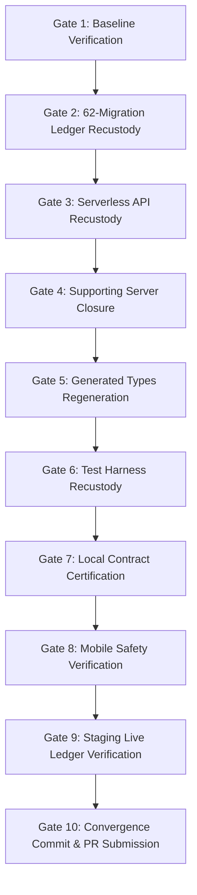

# HT-NR-01 — KERNEL CONVERGENCE EXECUTION PLAN

**Programme:** `HT-NR — HealthTimes Newsroom OS`  
**Execution Phase:** `HT-NR-01`  
**Role:** Newsroom Kernel Convergence Specialist  
**Governing Manifest:** `docs/newsroom/HT-NR-00_CANONICAL_RECUSTODY_MANIFEST.md`  
**Source Authority:** `755b7ba7aedaff0d3997a9f540572665c218d7e7` (PR #40 cumulative head)  
**Destination Authority:** `6994aa18d37e2189dbc1d3f8efc76a638ee0971c` (canonical `main`)  
**Target Staging Database:** `gcdohgbmqhqwydgaxrcr` (`ACTIVE_HEALTHY`)

---

## 1. OBJECTIVE & EXECUTION MANDATE

This document is the **deterministic, mechanical execution recipe** for phase `HT-NR-01`.
The specialist executing `HT-NR-01` must follow this plan sequentially from Gate 1 to Gate 10.
- **Do not merge PR #40.**
- **Do not rebase PR #40 onto `main`.**
- **Do not renumber or edit migrations.**
- **Do not alter mobile reader code.**
- **Do not execute DDL/DML on Staging.**
- Perform selective, file-by-file blob recustody as instructed below.

---

## 2. DETERMINISTIC STAGE GATES



---

### GATE 1: BASELINE VERIFICATION

1. **Create Execution Branch:**
   Branch strictly from canonical `main` (`6994aa18d37e2189dbc1d3f8efc76a638ee0971c`):
   ```bash
   git checkout main
   git pull origin main
   git checkout -b feat/ht-nr01-kernel-convergence
   ```

2. **Verify Clean Working Tree & Mobile Baseline:**
   ```bash
   git status --porcelain
   # Expect empty output (or only untracked local ignore artifacts)

   npm --prefix apps/mobile run typecheck
   # Expect exit 0, 0 errors
   ```

---

### GATE 2: 62-MIGRATION LEDGER RECUSTODY

1. **Restore First 60 Migrations & Lineage Manifest from PR #40:**
   ```bash
   # Checkout the 60 migration blobs from PR #40 head
   git checkout 755b7ba7aedaff0d3997a9f540572665c218d7e7 -- supabase/migrations/
   git checkout 755b7ba7aedaff0d3997a9f540572665c218d7e7 -- supabase/migration-lineage/healthtimes-staging-adoption.json
   ```

2. **Ensure Migrations 61 and 62 from `main` Remain Authoritative:**
   ```bash
   git checkout 6994aa18d37e2189dbc1d3f8efc76a638ee0971c -- supabase/migrations/20261002060846_ag05_premium_teaser_public_projection.sql
   git checkout 6994aa18d37e2189dbc1d3f8efc76a638ee0971c -- supabase/migrations/20261002061027_ag05_premium_teaser_helper_privilege_hardening.sql
   ```

3. **Verify Migration Ledger Completeness (62 Total):**
   ```bash
   MIGRATION_COUNT=$(ls -1 supabase/migrations/*.sql | wc -l | tr -d ' ')
   echo "Migrations count: $MIGRATION_COUNT"
   test "$MIGRATION_COUNT" -eq 62 || { echo "ERROR: Expected 62 migrations, found $MIGRATION_COUNT"; exit 1; }
   ```

---

### GATE 3: SERVERLESS API RECUSTODY

1. **Restore Authoritative Server APIs:**
   ```bash
   git checkout 755b7ba7aedaff0d3997a9f540572665c218d7e7 -- api/newsroom.js
   git checkout 755b7ba7aedaff0d3997a9f540572665c218d7e7 -- api/communications.js
   git checkout 755b7ba7aedaff0d3997a9f540572665c218d7e7 -- api/public.js
   git checkout 755b7ba7aedaff0d3997a9f540572665c218d7e7 -- api/discussion.js
   ```

2. **Preserve `api/commerce.js`:**
   ```bash
   git checkout 6994aa18d37e2189dbc1d3f8efc76a638ee0971c -- api/commerce.js
   ```

3. **Syntax and Dependency Smoke Check:**
   ```bash
   node -e "require('./api/newsroom.js'); console.log('api/newsroom syntax OK');"
   node -e "require('./api/communications.js'); console.log('api/communications syntax OK');"
   node -e "require('./api/public.js'); console.log('api/public syntax OK');"
   node -e "require('./api/discussion.js'); console.log('api/discussion syntax OK');"
   node -e "require('./api/commerce.js'); console.log('api/commerce syntax OK');"
   ```

---

### GATE 4: SUPPORTING SERVER CLOSURE

1. **Restore Test Servers & Edge Functions:**
   ```bash
   git checkout 755b7ba7aedaff0d3997a9f540572665c218d7e7 -- scripts/ag06/newsroom-test-server.js
   git checkout 755b7ba7aedaff0d3997a9f540572665c218d7e7 -- scripts/ag06/provision-staging-signups.mjs
   git checkout 755b7ba7aedaff0d3997a9f540572665c218d7e7 -- scripts/ca01/communications-test-server.js
   git checkout 755b7ba7aedaff0d3997a9f540572665c218d7e7 -- supabase/functions/ag06-certification-provision/index.ts
   git checkout 755b7ba7aedaff0d3997a9f540572665c218d7e7 -- supabase/functions/ca01-certification-provision/index.ts
   git checkout 755b7ba7aedaff0d3997a9f540572665c218d7e7 -- supabase/functions/com01-certification-provision/index.ts
   ```

2. **Restore Newsroom UI Assets:**
   ```bash
   git checkout 755b7ba7aedaff0d3997a9f540572665c218d7e7 -- newsroom.html newsroom.js newsroom.css
   ```

3. **Deploy Adapted `vercel.json`:**
   Write the adapted `vercel.json` specified in Section 9 of the Recustody Manifest.

---

### GATE 5: GENERATED TYPES REGENERATION

1. **Regenerate Types from Active Staging Database:**
   ```bash
   # Generate directly from Staging project gcdohgbmqhqwydgaxrcr
   npx supabase gen types typescript --project-id gcdohgbmqhqwydgaxrcr > apps/mobile/src/generated/database.types.ts
   ```

2. **Verify Mobile Compatibility:**
   ```bash
   npm --prefix apps/mobile run typecheck
   # Must succeed with 0 errors
   ```

---

### GATE 6: TEST HARNESS RECUSTODY

1. **Restore Server Contract & Security Test Suites:**
   ```bash
   git checkout 755b7ba7aedaff0d3997a9f540572665c218d7e7 -- tests/ag06-security-contract.spec.js
   git checkout 755b7ba7aedaff0d3997a9f540572665c218d7e7 -- tests/ag06-live-security.spec.js
   git checkout 755b7ba7aedaff0d3997a9f540572665c218d7e7 -- tests/ca01-contract.spec.js
   git checkout 755b7ba7aedaff0d3997a9f540572665c218d7e7 -- tests/ca01-live-security.spec.js
   git checkout 755b7ba7aedaff0d3997a9f540572665c218d7e7 -- tests/com01-contract.spec.js
   git checkout 755b7ba7aedaff0d3997a9f540572665c218d7e7 -- tests/newsroom-os.spec.js
   ```

---

### GATE 7: LOCAL CONTRACT CERTIFICATION

1. **Run Standalone Contract Test Suites:**
   ```bash
   npm run test:ag06:contract
   npm run test:ca01:contract
   npm run test:com01:contract
   ```

---

### GATE 8: MOBILE SAFETY VERIFICATION

1. **Run Full Mobile Suite to Prove Zero Regressions:**
   ```bash
   npm --prefix apps/mobile run lint
   npm --prefix apps/mobile run typecheck
   npm --prefix apps/mobile run test -- --watchAll=false
   ```

---

### GATE 9: STAGING LIVE LEDGER VERIFICATION

1. **Verify Live Staging Ledger Alignment (Read-Only):**
   ```bash
   # Compare local migration filenames against live staging
   # Staging project gcdohgbmqhqwydgaxrcr must show all 62 migrations accounted for.
   # NO DDL OR DML MUST BE EXECUTED ON STAGING.
   ```

---

### GATE 10: CONVERGENCE COMMIT & PR SUBMISSION

1. **Stage Recustodied Files Exclusively:**
   ```bash
   git add \
     api/communications.js \
     api/discussion.js \
     api/newsroom.js \
     api/public.js \
     apps/mobile/src/generated/database.types.ts \
     newsroom.css \
     newsroom.html \
     newsroom.js \
     scripts/ag06/newsroom-test-server.js \
     scripts/ag06/provision-staging-signups.mjs \
     scripts/ca01/communications-test-server.js \
     supabase/functions/ \
     supabase/migration-lineage/healthtimes-staging-adoption.json \
     supabase/migrations/ \
     tests/ag06-live-security.spec.js \
     tests/ag06-security-contract.spec.js \
     tests/ca01-contract.spec.js \
     tests/ca01-live-security.spec.js \
     tests/com01-contract.spec.js \
     tests/newsroom-os.spec.js \
     vercel.json
   ```

2. **Commit with Deterministic Message:**
   ```bash
   git commit -m "feat(newsroom): canonical server-authority recustody (HT-NR-01)

   - Recustodied 60 historical migrations from PR #40 and unified with 2 main Premium migrations (62 total)
   - Restored serverless APIs: api/newsroom.js, api/communications.js, api/public.js, api/discussion.js
   - Preserved canonical api/commerce.js and all apps/mobile reader architecture
   - Regenerated database.types.ts against active Staging (gcdohgbmqhqwydgaxrcr)
   - Restored contract test suites (ag06, ca01, com01) and adapted vercel.json"
   ```

3. **Push to Remote and Open PR:**
   ```bash
   git push origin feat/ht-nr01-kernel-convergence
   gh pr create \
     --title "feat(newsroom): canonical server-authority recustody (HT-NR-01)" \
     --body "Follows HT-NR-00C recustody manifest and execution plan. Recustodies the 62-migration database ledger, serverless Newsroom/Communications APIs, Edge Functions, and contract tests without altering canonical Mobile/Reader history."
   ```

---

## 3. HT-NR-01 RETURN RECEIPT TEMPLATE

Upon completion, the HT-NR-01 specialist must submit the following return receipt:

```markdown
# HT-NR-01 RETURN RECEIPT — CANONICAL KERNEL CONVERGENCE

- **Branch:** `feat/ht-nr01-kernel-convergence`
- **Starting Base SHA:** `6994aa18d37e2189dbc1d3f8efc76a638ee0971c` (`main`)
- **Final Convergence SHA:** `<NEW_COMMIT_SHA>`
- **Total Migrations in Repository:** 62
- **First 60 Migrations Source:** PR #40 (`755b7ba7aedaff0d3997a9f540572665c218d7e7`)
- **Final 2 Migrations Source:** Canonical `main` (`20261002060846`, `20261002061027`)
- **Live Staging Database Status:** `gcdohgbmqhqwydgaxrcr` (Verified 62 migrations, ZERO mutations applied)
- **Recustodied APIs:**
  - `api/newsroom.js` (Blob `f3520094832ad255d4e5a325430b2e51296af64f`)
  - `api/communications.js` (Blob `d09ef467bea7435a1aee9e941d3a4e810c5de348`)
  - `api/public.js` (Blob `2354d14094aafb0ab92429caa87bd31e00871127`)
  - `api/discussion.js` (Blob `385897f3293740394baeb16df724ae6097da1dae`)
- **Preserved Main APIs:**
  - `api/commerce.js` (Blob `ff899e65f2fe60f3c1563f2a55581c511ab44214`)
- **Type Generation:**
  - Regenerated `apps/mobile/src/generated/database.types.ts`
  - Mobile Typecheck: PASSED (0 errors)
- **Contract Tests Passed:**
  - `test:ag06:contract`: PASSED
  - `test:ca01:contract`: PASSED
  - `test:com01:contract`: PASSED
- **Mobile Reader Safety Check:**
  - `apps/mobile/app/**`: UNTOUCHED
  - `apps/mobile/src/ui/**`: UNTOUCHED
  - `apps/mobile` tests: ALL PASSED
- **Pull Request:** `<PR_URL>`
```
