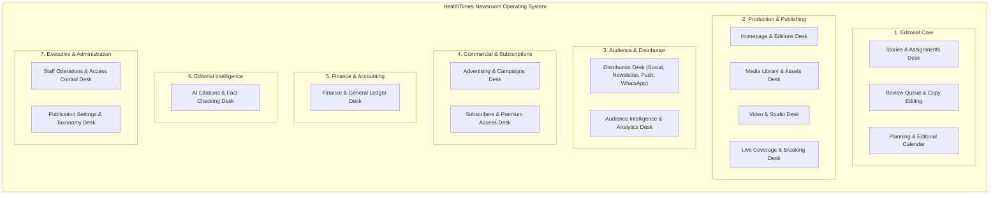

# HT-NR-UI-02 Launch Hardening & Convergence Summary

**Programme:** HealthTimes Newsroom OS  
**Milestone:** HT-NR-UI-02 Final Launch Candidate  
**Controlling PR Base:** PR #106 (`d1b49126513fa288160db6e64c918b7a98ffbf16`)  
**Base Candidate:** PR #117 / HT-NR-UI-01 (`cd2bc75dd6fcd03b9afc869bd25ccda3067bd435`)  
**Target Candidate:** PR #118 / HT-NR-UI-02  
**Status:** `READY_FOR_OWNER_FINAL_NEWSROOM_UAT`

---

## 1. Executive Summary

HT-NR-UI-02 represents the final pre-launch security hardening, double-entry financial accounting ledger convergence, and first-owner authentication rollout for the HealthTimes Newsroom Operating System.

Building directly upon the 7-domain role-based architecture established in HT-NR-UI-01, HT-NR-UI-02 closes the final operational, security, and financial gaps required for full editorial and executive deployment:

1. **First-Owner Authentication & Security Boundary:** Completely eliminated insecure parameterized bootstrap RPCs. Implemented parameterless `newsroom_bootstrap_owner()` strictly bounded to `kudzimusar@gmail.com` and invitation `3c277c48-5319-429f-a2c3-1bf2dbae4c2a`. Added dedicated activation UI (`/studio/activate`).
2. **Access Control List (ACL) Hardening:** Revoked direct DML privileges on `authors` and `sections` from `anon` and `public`. Enforced strict RLS and capability checks.
3. **Double-Entry General Ledger (GL) & Financial Reporting:** Implemented GAAP-compliant double-entry accounting with Chart of Accounts (COA), Fiscal Periods, Journal Entries, Journal Lines, Credit Notes, Automated Operational Posting triggers, and real-time Statement RPCs (Trial Balance, Profit & Loss, Balance Sheet, Customer Statement of Account).
4. **Role-Based UI Hardening:** Hardened `Studio.tsx` and `StudioFinanceDesk.tsx` with role-based domain filtering, ensuring staff members only see domains and desks corresponding to their authorized capabilities.
5. **Exact-Head CI & Zero Data Pollution:** Maintained staging database zero-state (no fabricated transactions outside rollback tests), passing all 669 test assertions across the mobile test suite and 15/15 database tests.

---

## 2. Operating Architecture: 7 Domains & 12 Desks

The HealthTimes Newsroom OS structures publication operations into 7 discrete operating domains and 12 specialized desks:

---

## 3. Complete Capability Domain Union (74 Capabilities)

All 74 canonical newsroom capabilities in `newsroom_capabilities` are mapped into the 5 discrete functional domains:

1. **Editorial (26 capabilities):**
   - `story.create`, `story.edit`, `story.view`, `story.delete`, `story.submit_review`, `story.review`, `story.request_changes`, `story.publish`, `story.schedule`, `story.unpublish`, `story.restore_revision`, `story.manage_metadata`
   - `assignment.create`, `assignment.view`, `assignment.manage`, `assignment.progress`
   - `media.upload`, `media.view`, `media.manage`, `media.delete`
   - `comment.view`, `comment.moderate`, `comment.policy_manage`
   - `communication.threads_view`, `communication.threads_participate`, `communication.threads_moderate`

2. **Commercial (14 capabilities):**
   - `commercial.view`, `commercial.manage`, `commercial.leads_manage`
   - `ads.create`, `ads.view`, `ads.manage`, `ads.delete`, `ads.approve`
   - `subscriber.view`, `subscriber.manage`, `subscriber.export`
   - `premium.packages_manage`, `premium.entitlements_view`, `premium.entitlements_manage`

3. **Finance (12 capabilities):**
   - `finance.view`, `finance.manage`
   - `finance.invoices_create`, `finance.invoices_manage`, `finance.invoices_approve`
   - `finance.payments_record`, `finance.payments_refund`
   - `finance.expenses_create`, `finance.expenses_approve`
   - `finance.gl_view`, `finance.gl_post`, `finance.reports_generate`

4. **Audience & Distribution (11 capabilities):**
   - `distribution.channels_view`, `distribution.channels_manage`
   - `social.post`, `social.manage`, `social.analytics_view`
   - `marketing.campaigns_create`, `marketing.campaigns_manage`
   - `push.send`, `push.manage`
   - `newsletter.compose`, `newsletter.send`

5. **Executive & Administration (11 capabilities):**
   - `staff.view`, `staff.manage`, `staff.invite`, `staff.roles_manage`, `staff.sessions_revoke`
   - `settings.view`, `settings.manage`
   - `security.audit_view`, `security.mfa_enforce`
   - `analytics.editorial_view`, `analytics.executive_view`

---

## 4. Migration Summary (Staging Migrations 93–95)

| Migration Version | File Name | Description | Verification |
|---|---|---|---|
| `20261021020000` | `20261021020000_ht_nr_ui02_bootstrap_security_hardening.sql` | Drops parameterized bootstrap; deploys parameterless `newsroom_bootstrap_owner()` strictly bounded to `kudzimusar@gmail.com` and invitation `3c277c48-5319-429f-a2c3-1bf2dbae4c2a`. | Migration 93 applied; tests pass. |
| `20261021030000` | `20261021030000_ht_nr_ui02_acl_hardening.sql` | Revokes direct DML on `authors` and `sections` from `anon` and `public`; enforces RLS and verified capabilities. | Migration 94 applied; tests pass. |
| `20261021040000` | `20261021040000_ht_nr_ui02_general_ledger.sql` | Deploys double-entry GL tables, immutability triggers, automated operational posting triggers, and GAAP statement RPCs. | Migration 95 applied; tests pass. |

---

## 5. Test Suite Verification Summary

- **Mobile Unit & Contract Tests:** 669 tests pass, 0 failed (`node --test tests/*.test.mjs`).
- **Newsroom OS Specialized Tests:** 466 tests pass, 0 failed (`node --test tests/ht-nr*.test.mjs`).
- **TypeScript Static Verification:** 0 errors (`npx tsc --noEmit`).
- **Database Test Suite:** 15/15 tests pass in clean rollback transaction (`supabase/tests/ht_nr_ui02_gl_and_bootstrap_tests.sql`).
